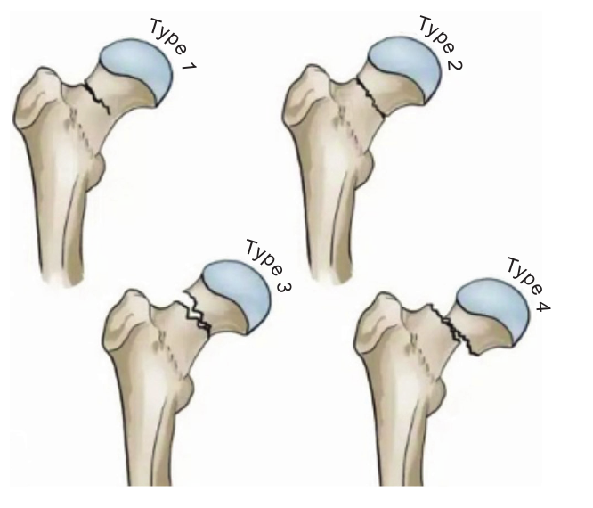
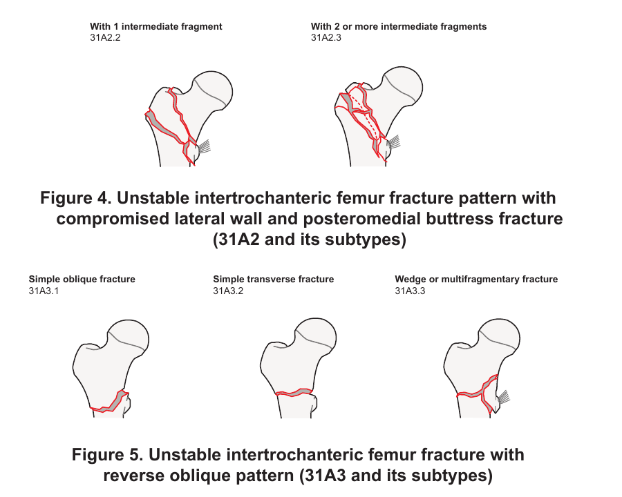

# CPG-MCQs — Review set: 5 reworked questions per guideline

For review by you and your colleague. Nothing here is on the live site yet. If approved, these replace the weaker original questions (shown as "Replaces").

Format: clinical vignette, optional table or figure from the CPG, five statements (I–V), five combination options (A–E). Statements are scored individually in the explanation.

---

## CPG Gout 2021

### Gout 2021 — Q1

A 58-year-old man with hypertension, BMI 31 kg/m2 and recurrent podagra (3 flares this year) takes hydrochlorothiazide 25 mg, bisoprolol 5 mg and amlodipine 5 mg. His BP is 148/92 mmHg. A physician wants to change the regimen to help his gout while still controlling BP.

*Adapted from CPG Table 1 (antihypertensives and gout risk)*

| Raises gout risk | Lowers gout risk |
|---|---|
| Diuretics (loop, thiazide, thiazide-like; not potassium-sparing) | Losartan |
| Non-losartan ARBs | Calcium channel blockers |
| ACE inhibitors | - |
| Beta-blockers | - |

**I.** Switching bisoprolol to valsartan lowers gout risk because valsartan shares the urate-lowering effect of losartan.  
**II.** Amlodipine can be continued because calcium channel blockers lower gout risk.  
**III.** Potassium-sparing diuretics are not among the diuretics that raise gout risk.  
**IV.** Replacing amlodipine with perindopril is preferred because ACE inhibitors are neutral for gout.  
**V.** Replacing hydrochlorothiazide with losartan removes a gout-promoting drug and adds a protective one.  

**Which of the following statements about changing his regimen are correct?**

A. II, III and V only  
B. I, II and III only  
C. III, IV and V only  
D. II, III, IV and V only  
E. I, III and V only  

**Answer:** A

**Statement check:** I ✘ false · II ✔ true · III ✔ true · IV ✘ false · V ✔ true

**Explanation:** Diuretics, non-losartan ARBs, ACE inhibitors and beta-blockers raise gout risk, whereas losartan and calcium channel blockers lower it, and the CPG advises avoiding or replacing diuretics. Replacing the thiazide with losartan while keeping amlodipine is the best change. Valsartan is a non-losartan ARB, so it does not share losartan's effect, and perindopril, an ACE inhibitor, raises risk.

**Reference:** Malaysian CPG Management of Gout (2nd Ed.), Section 3.1, Table 1; Recommendation 1.

*Replaces:* A 58-year-old man with hypertension, BMI 31 kg/m2 and recurrent podagra (3 flares this year) takes hydrochlorothiazide 25 mg, bisoprolol 5 mg and amlodipine 5 m…

### Gout 2021 — Q2

A 68-year-old woman with long-standing hypertension on hydrochlorothiazide and CKD stage 3 presents with a hot, swollen, very painful right knee for 2 days. She had a steroid injection into the knee 5 days ago. She has no tophi and no previous flares. Her son suggests treating it as gout with colchicine at home.

*Admission results*

| Parameter | Result | Comment |
|---|---|---|
| Temperature | 38.6 C | Febrile |
| Pulse | 112/min | Tachycardia |
| White cell count | 17 x10^9/L | Raised |
| CRP | 210 mg/L | Markedly raised |
| Serum urate | 0.58 mmol/L | CPG ULT target is below 0.36 |

**I.** Septic arthritis must be excluded by joint aspiration with Gram stain and culture before the knee is treated as gout.  
**II.** Her hyperuricaemia is explained in part by thiazide use and CKD.  
**III.** Starting colchicine with review in 48 hours is acceptable because her urate is above the ULT target.  
**IV.** A raised serum urate does not exclude infection, because gout and septic arthritis can coexist.  
**V.** The recent intra-articular steroid injection makes joint infection less likely.  

**Which of the following statements are correct?**

A. II, IV and V only  
B. I, III and IV only  
C. I, II and III only  
D. I, II, IV and V only  
E. I, II and IV only  

**Answer:** E

**Statement check:** I ✔ true · II ✔ true · III ✘ false · IV ✔ true · V ✘ false

**Explanation:** In acute monoarthritis septic arthritis is the key differential. She has a knee joint, fever, tachycardia, leucocytosis, a CRP of 210 mg/L and a recent injection, all of which raise the probability of infection. Urate is raised by thiazide and CKD and does not discriminate. Aspiration for culture and crystals is needed before treating as gout.

**Reference:** Malaysian CPG Management of Gout (2nd Ed.), Section 9 (Differential diagnoses).

*Replaces:* A 68-year-old woman with long-standing hypertension on hydrochlorothiazide and CKD stage 3 presents with a hot, swollen, very painful right knee for 2 days. Tem…

### Gout 2021 — Q3

A 62-year-old Han Chinese man with CKD stage 3 is started on allopurinol 300 mg daily by a locum because "that's the usual dose". Three weeks later he develops a widespread rash, mucosal ulceration, facial swelling and fever, with a rising ALT and eosinophil count.

*Features of this patient mapped against allopurinol hypersensitivity syndrome (CPG Section 15.3 and Appendix 5)*

| Feature | This patient | CPG comment |
|---|---|---|
| Starting dose | 300 mg daily | Start at 50 or 100 mg and titrate slowly |
| Renal function | CKD stage 3 | Risk factor |
| Ancestry | Han Chinese | HLA-B*58:01 more prevalent |
| Timing | Week 3 | About 90% occur within 180 days, median 30 days |

**I.** About 90% of cases of allopurinol hypersensitivity syndrome occur within the first 180 days.  
**II.** Allopurinol can be re-introduced at a lower dose once the rash has settled.  
**III.** Allopurinol should be started at 50 or 100 mg daily and titrated slowly, especially in renal impairment.  
**IV.** HLA-B*58:01 is more prevalent in Han Chinese, Korean and Thai populations.  
**V.** The reaction can be managed by reducing the dose and adding an antihistamine.  

**Which of the following statements are correct?**

A. I only  
B. I, II and III only  
C. II, III and IV only  
D. I, III and IV only  
E. I and IV only  

**Answer:** D

**Statement check:** I ✔ true · II ✘ false · III ✔ true · IV ✔ true · V ✘ false

**Explanation:** A high starting dose, renal impairment and HLA-B*58:01 are the recognised risk factors. The picture of rash, mucosal ulceration, eosinophilia and hepatitis is a severe cutaneous adverse reaction. Allopurinol must be stopped immediately and not re-challenged, and dose reduction with antihistamines is inadequate.

**Reference:** Malaysian CPG Management of Gout (2nd Ed.), Section 12.2a; Section 15.3.

*Replaces:* A 62-year-old Han Chinese man with CKD stage 3 is started on allopurinol 300 mg daily by a locum because "that's the usual dose". Three weeks later he develops …

### Gout 2021 — Q4

A 49-year-old man with BMI 33 kg/m2 has had 4 flares in a year. He drinks 3 beers a night, takes sugar-sweetened soft drinks daily, eats red meat twice daily, and has tried a cherry supplement. He eats oily fish rarely and asks which dietary changes matter most.

**I.** Purine-rich vegetables and soy products should be avoided because they raise flare risk.  
**II.** Omega-3 supplements are recommended because they reduce flares as dietary fish does.  
**III.** All types of alcohol should be limited, with risk rising significantly above two servings.  
**IV.** High-fructose corn syrup, as in sweetened soft drinks, should be limited.  
**V.** Purine-rich foods of animal origin should be limited, but omega-3-rich fish is acceptable.  

**Which of the following statements are correct?**

A. I, II, III, IV and V only  
B. V only  
C. III, IV and V only  
D. III and V only  
E. I, III and V only  

**Answer:** C

**Statement check:** I ✘ false · II ✘ false · III ✔ true · IV ✔ true · V ✔ true

**Explanation:** The CPG advises weight loss, limiting alcohol (beer, wine and spirits alike), animal purines (except omega-3-rich fish) and high-fructose corn syrup. Purine-rich vegetables and soy did not increase risk, and omega-3 supplements, unlike dietary fish, were not linked to fewer flares.

**Reference:** Malaysian CPG Management of Gout (2nd Ed.), Section 12.1b; Recommendation 5.

*Replaces:* A 49-year-old man with BMI 33 kg/m2 has had 4 flares in a year. He drinks 3 beers a night, takes sugar-sweetened soft drinks daily, eats red meat twice daily, a…

### Gout 2021 — Q5

A 61-year-old man presents with an acutely swollen right knee. Aspiration shows needle-shaped crystals with strong yellow colour when parallel to the compensator axis. Serum urate that day is 0.31 mmol/L.

*Polarised light features of the two common synovial crystals*

| Feature | Monosodium urate (gout) | Calcium pyrophosphate |
|---|---|---|
| Shape | Needle | Rhomboid |
| Birefringence | Negative (yellow parallel to axis) | Weakly positive (blue parallel to axis) |

**I.** Under the ACR/EULAR approach, crystals in a symptomatic joint are a sufficient criterion for gout.  
**II.** A normal serum urate on the day of a flare does not exclude gout.  
**III.** Demonstration of MSU crystals in synovial fluid is the gold standard diagnostic test.  
**IV.** A classification score of at least 8 is still required when MSU crystals have been seen.  
**V.** Calcium pyrophosphate crystals are needle-shaped and strongly negatively birefringent.  

**Which of the following statements are correct?**

A. I and II only  
B. II, III and V only  
C. I, II and III only  
D. I, III and V only  
E. III only  

**Answer:** C

**Statement check:** I ✔ true · II ✔ true · III ✔ true · IV ✘ false · V ✘ false

**Explanation:** MSU crystals are needle-shaped and negatively birefringent, are the gold standard and are sufficient to classify gout without scoring. Urate may be normal or low during a flare. Calcium pyrophosphate crystals are rhomboid and weakly positively birefringent.

**Reference:** Malaysian CPG Management of Gout (2nd Ed.), Section 7.1; Section 7.3; Table 2 (sufficient criterion).

*Replaces:* A 61-year-old man presents with an acutely swollen right knee. Aspiration shows needle-shaped, negatively birefringent crystals under polarised light, with stro…

---

## CPG Rheumatoid Arthritis

### Rheumatoid Arthritis — Q1

A 48-year-old woman with RA on methotrexate is reviewed in clinic. Her 28-joint count shows 6 tender and 4 swollen joints. The patient global assessment is 4.0 cm and the physician global assessment is 3.5 cm (both 0-10 cm VAS). ESR and CRP are available.

*Adapted from CPG Appendix 3 (CDAI bands)*

| CDAI | Disease activity |
|---|---|
| 2.8 or less | Remission |
| Above 2.8 to 10 | Low |
| Above 10 to 22 | Moderate |
| Above 22 | High |

**I.** Because the target is not met, treatment should be intensified.  
**II.** The CDAI is calculated using ESR or CRP, so these results are needed to score her.  
**III.** The treat-to-target goal is remission, or at least low disease activity, within 6 months.  
**IV.** Her CDAI is 17.5, which is moderate disease activity.  
**V.** A CDAI of 17.5 is low disease activity, so current therapy can be continued.  

**Which of the following statements are correct?**

A. II, III and IV only  
B. I, III and IV only  
C. I, II, III, IV and V only  
D. I and IV only  
E. I, II and III only  

**Answer:** B

**Statement check:** I ✔ true · II ✘ false · III ✔ true · IV ✔ true · V ✘ false

**Explanation:** CDAI is the sum of tender joints, swollen joints, patient global and physician global (6 + 4 + 4 + 3.5 = 17.5), with no acute-phase reactant. This is moderate activity, so the target is not met and therapy should be intensified, for example with a second csDMARD, or a biologic or targeted synthetic DMARD if csDMARDs fail.

**Reference:** Malaysian CPG Management of Rheumatoid Arthritis, Section 7; Appendix 3; Recommendation 4.

*Replaces:* A 48-year-old woman with RA on methotrexate has 6 tender and 4 swollen joints (28-joint count). Her global assessment of disease activity is 4 cm and the physic…

### Rheumatoid Arthritis — Q2

A 58-year-old man on methotrexate 20 mg weekly with folic acid has routine blood tests at 6 months.

*Results, with the CPG Appendix 7 threshold for considering interruption*

| Test | Result | Threshold to consider interrupting |
|---|---|---|
| WBC | 3.2 x10^9/L | Below 3.5 |
| Neutrophils | 1.4 x10^3/L | Below 1.6 |
| Platelets | 168 x10^9/L | Below 140 |
| MCV | 98 fL | Above 105 |
| ALT | 1.5 x ULN | Above 3 x ULN |
| Creatinine | Unchanged | Rise above 30% |

**I.** An ALT of 1.5 x ULN meets the threshold for interrupting methotrexate.  
**II.** Early consultation with the rheumatology team is advised.  
**III.** The WBC and neutrophil count both breach the thresholds for considering interruption of methotrexate.  
**IV.** Monitoring can now be extended to 6-monthly because he has been stable for 6 months.  
**V.** Platelets, MCV and creatinine are within acceptable limits.  

**Which of the following statements are correct?**

A. I, II and III only  
B. V only  
C. II and V only  
D. I, III and V only  
E. II, III and V only  

**Answer:** E

**Statement check:** I ✘ false · II ✔ true · III ✔ true · IV ✘ false · V ✔ true

**Explanation:** A WBC below 3.5 and neutrophils below 1.6 meet the CPG thresholds, so early rheumatology consultation and consideration of interrupting treatment are advised. ALT is raised but below the 3 x ULN threshold. Monitoring is 2-4 weekly for 3 months or after each dose increase, then 3-monthly.

**Reference:** Malaysian CPG Management of Rheumatoid Arthritis, Appendix 7.

*Replaces:* A 58-year-old man on methotrexate 20 mg weekly and folic acid has routine blood tests at 6 months: Test  |  Result WBC  |  3.2 x 10^9/L Neutrophils  |  1.4 x 10…

### Rheumatoid Arthritis — Q3

A 55-year-old man with RA has persistent moderate disease activity despite methotrexate and sulfasalazine for 8 months. His rheumatologist plans a TNF inhibitor. HBsAg is negative. He lived with a relative who had tuberculosis 20 years ago. Chest X-ray is normal and he has no cough, fever or weight loss.

**I.** Hepatitis C screening is needed only if the ALT is raised.  
**II.** A normal chest X-ray does not exclude latent TB, so a Mantoux with or without IGRA is needed after TB contact.  
**III.** Hepatitis B core antibody should be checked even though HBsAg is negative.  
**IV.** HIV, hepatitis B and C and TB screening are required before any biologic or targeted synthetic DMARD.  
**V.** Immunoglobulin levels (IgG, IgA, IgM) are required before starting a TNF inhibitor.  

**Which of the following statements about pre-biologic screening are correct?**

A. II, III and V only  
B. III, IV and V only  
C. I, II, III and IV only  
D. I, II and III only  
E. II, III and IV only  

**Answer:** E

**Statement check:** I ✘ false · II ✔ true · III ✔ true · IV ✔ true · V ✘ false

**Explanation:** All patients are screened for TB (Mantoux with or without IGRA plus chest X-ray), hepatitis B (HBsAg and anti-HBc), hepatitis C and HIV before biologics or targeted synthetic DMARDs. Immunoglobulin levels are needed before rituximab, not a TNF inhibitor. Anti-TNF therapy in particular raises the risk of TB reactivation.

**Reference:** Malaysian CPG Management of Rheumatoid Arthritis, Section 3.1, Table 1; Recommendation 9; Appendix 8.

*Replaces:* A 55-year-old man with RA has persistent moderate disease activity despite methotrexate and sulfasalazine for 8 months. His rheumatologist plans a TNF inhibitor…

### Rheumatoid Arthritis — Q4

A 31-year-old woman with well-controlled RA on methotrexate 15 mg weekly and folic acid wishes to conceive within 4 months. She is not using contraception reliably.

*Adapted from CPG Section 7.2.3 and Appendix 6 (RA drugs and pregnancy)*

| Drug | Advice |
|---|---|
| Methotrexate | Contraindicated; stop at least 3 months before conception |
| Leflunomide | Washout needed before conception |
| Tofacitinib | Stop 2 months before conception |
| Hydroxychloroquine, sulfasalazine (with folate) | Compatible |
| Infliximab, adalimumab | Continue to about week 20 |
| Etanercept | Continue to about week 30-32 |

**I.** Leflunomide can be continued until conception because no washout is needed.  
**II.** Methotrexate should be stopped at least 3 months before conception.  
**III.** Hydroxychloroquine and sulfasalazine with folate are compatible options.  
**IV.** Tofacitinib is a suitable replacement because it can be taken throughout pregnancy.  
**V.** Etanercept can be continued to about week 30-32, longer than infliximab or adalimumab.  

**Which of the following statements are correct?**

A. II, III and V only  
B. I, II, III, IV and V only  
C. I, II, III and V only  
D. I, II and V only  
E. III only  

**Answer:** A

**Statement check:** I ✘ false · II ✔ true · III ✔ true · IV ✘ false · V ✔ true

**Explanation:** Methotrexate is contraindicated in pregnancy and breastfeeding and should stop at least 3 months before conception. Leflunomide needs a washout and tofacitinib should be stopped 2 months before. Hydroxychloroquine, sulfasalazine and TNF inhibitors (with the stated limits) are compatible, and pre-pregnancy care referral is indicated.

**Reference:** Malaysian CPG Management of Rheumatoid Arthritis, Section 7.2.3; Section 10.2; Appendix 6.

*Replaces:* A 31-year-old woman with well-controlled RA on methotrexate 15 mg weekly and folic acid wishes to conceive within 4 months. She is not currently using contracep…

### Rheumatoid Arthritis — Q5

A 49-year-old woman is diagnosed with active RA (CDAI 28). Methotrexate is started. She is in severe pain and her GP asks about steroids. She has osteopenia on a DXA scan 2 years ago and mild hypertension.

**I.** Her osteopenia is an absolute contraindication to short-term steroid bridging.  
**II.** Calcium, vitamin D and surveillance for infection are needed during corticosteroid treatment.  
**III.** Continuous low-dose prednisolone is recommended for long-term maintenance once methotrexate is started.  
**IV.** Prednisolone is preferred to dexamethasone or betamethasone because it suppresses the HPA axis less.  
**V.** Short-term (under 3 months) low-dose prednisolone, 10 mg daily or less, may bridge the weeks before csDMARDs act.  

**Which of the following statements are correct?**

A. II, IV and V only  
B. II only  
C. I, IV and V only  
D. V only  
E. II and IV only  

**Answer:** A

**Statement check:** I ✘ false · II ✔ true · III ✘ false · IV ✔ true · V ✔ true

**Explanation:** csDMARDs can take up to 8 weeks to act, so low-dose prednisolone (10 mg or less) for under 3 months may be used as bridging. Prednisolone is preferred because it suppresses the HPA axis less. Long-term use predisposes to osteoporosis and infection, so bone protection and monitoring are needed, but osteopenia does not forbid short-term use.

**Reference:** Malaysian CPG Management of Rheumatoid Arthritis, Section 7.2.2; Recommendation 7.

*Replaces:* A 49-year-old woman is diagnosed with active RA (CDAI 28). Methotrexate is started. She is in severe pain and her GP asks about steroids. She has osteopenia on …

---

## CPG Obesity 2023

### Obesity 2023 — Q1

A 41-year-old Malaysian-Chinese man attends an insurance medical. He weighs 80 kg and is 1.70 m tall. Waist circumference is 94 cm, BP 126/78 mmHg and fasting glucose 5.3 mmol/L. He has no symptoms and takes no medication.

*Adapted from CPG Table 2-1 (BMI classification for Asian adults)*

| Class | BMI (kg/m2) |
|---|---|
| Normal | 18.5-22.9 |
| Pre-obese | 23.0-27.4 |
| Obese I | 27.5-32.4 |
| Obese II | 32.5-37.4 |
| Obese III | 37.5 or more |

**I.** Lifestyle intervention with assessment for associated conditions is appropriate.  
**II.** On WHO Caucasian cut-offs he would also be classified as obese, so the two systems agree.  
**III.** Pharmacotherapy is not indicated, because it needs BMI of 30 or more, or 27 or more with a comorbidity.  
**IV.** His BMI is 27.7 kg/m2, which is Obese I by the Asian cut-offs.  
**V.** Bariatric surgery assessment is indicated because his BMI exceeds 27.5.  

**Which of the following statements are correct?**

A. I, II and III only  
B. I, III and IV only  
C. I, II, III and IV only  
D. III, IV and V only  
E. I, II and IV only  

**Answer:** B

**Statement check:** I ✔ true · II ✘ false · III ✔ true · IV ✔ true · V ✘ false

**Explanation:** BMI = 80 / 1.70 squared = 27.7 kg/m2, which is Obese I in Asians (27.5-32.4). Drug therapy needs BMI of 30 or more, or 27 or more with a comorbidity, and he has none. Bariatric surgery needs 37.5 or more, or 32.5 or more with comorbidity. On WHO bands 27.7 is overweight, not obese.

**Reference:** Malaysian CPG Management of Obesity (2nd Ed., 2023), Section 2.2, Table 2-1; Section 2.3.

*Replaces:* A 41-year-old Malaysian-Chinese man attends an insurance medical. He weighs 80 kg and is 1.70 m tall. Waist circumference is 94 cm, BP 126/78 mmHg and fasting g…

### Obesity 2023 — Q2

A 74-year-old woman has BMI 22 kg/m2 but has lost muscle bulk over several years. She has diabetes and hypertension and a waist circumference of 92 cm. Her grandson says she cannot be "overweight" because her BMI is normal.

**I.** BMI cannot separate muscle from fat or show fat distribution.  
**II.** Sarcopenia in older people means a normal BMI can underestimate body fat.  
**III.** The CPG recommends higher BMI cut-offs for adults over 70 years.  
**IV.** Her waist circumference of 92 cm exceeds the Asian threshold for women of 80 cm.  
**V.** Waist circumference adds no information once BMI is in the normal range.  

**Which of the following statements are correct?**

A. I only  
B. II and IV only  
C. I, IV and V only  
D. I, II and IV only  
E. II, IV and V only  

**Answer:** D

**Statement check:** I ✔ true · II ✔ true · III ✘ false · IV ✔ true · V ✘ false

**Explanation:** Older people carry a higher body-fat proportion because of sarcopenia, so BMI can misclassify adiposity as healthy, and it does not show fat distribution. Waist circumference (92 cm against an Asian female threshold of 80 cm) and fat measures give a better estimate of risk. The CPG does not adjust BMI cut-offs by age.

**Reference:** Malaysian CPG Management of Obesity (2nd Ed., 2023), Section 2.2 (Limitations of BMI).

*Replaces:* A 74-year-old woman has BMI 22 kg/m2 but has lost muscle bulk over several years. She has diabetes, hypertension and a waist circumference of 92 cm. Her grandso…

### Obesity 2023 — Q3

A 38-year-old Malay woman has BMI 24.8 kg/m2 and waist circumference 86 cm. A colleague points out that the WHO cut-off for women is 88 cm and says she is "fine".

*Waist circumference thresholds for central obesity (CPG Section 2.2)*

| Population | Men | Women |
|---|---|---|
| Asian (CPG) | 90 cm or more | 80 cm or more |
| WHO (Caucasian) | 102 cm or more | 88 cm or more |

**I.** Her waist circumference of 86 cm exceeds the Asian threshold even though it is below the WHO cut-off.  
**II.** The WHO thresholds of 102 cm and 88 cm should be applied to Asians because they were validated in Asian populations.  
**III.** Her BMI of 24.8 kg/m2 already falls in the Asian pre-obese band of 23.0-27.4.  
**IV.** Waist circumference is most informative in people whose BMI is above 35 kg/m2.  
**V.** The Asian thresholds are 90 cm in men and 80 cm in women.  

**Which of the following statements are correct?**

A. III and V only  
B. I only  
C. III, IV and V only  
D. I, III and V only  
E. III only  

**Answer:** D

**Statement check:** I ✔ true · II ✘ false · III ✔ true · IV ✘ false · V ✔ true

**Explanation:** Asian studies show a high prevalence of T2DM and CVD at lower waist cut-offs, so 80 cm applies to women. Waist circumference is most useful in people with normal or pre-obese BMI, as in her case.

**Reference:** Malaysian CPG Management of Obesity (2nd Ed., 2023), Section 2.2.

*Replaces:* A 38-year-old Malay woman has BMI 24.8 kg/m2 and waist circumference 86 cm. A colleague points out that the WHO cut-off for women is 88 cm and says she is "fine…

### Obesity 2023 — Q4

A 45-year-old man with BMI 33 kg/m2, hypertension and hyperlipidaemia weighs 98 kg. He sets himself a goal of losing 20 kg in 8 weeks.

*His goal compared with the CPG's realistic goals (Section 4.1.1)*

| Measure | His goal | CPG realistic goal |
|---|---|---|
| Rate of loss | 2.5 kg per week | Up to 1 kg per week |
| Total loss | 20 kg (about 20% of baseline) | Up to 10% of baseline weight |
| Initial target with CV risk factors | - | 3-5% of baseline (about 3-5 kg) |

**I.** A loss of 3-5% has no meaningful effect on cardiovascular risk factors.  
**II.** Losing 20 kg in 8 weeks is achievable with a very-low-calorie diet and is recommended at BMI 33.  
**III.** With cardiovascular risk factors an initial target of 3-5% of baseline weight is appropriate.  
**IV.** A very-low-calorie diet (below 800 kcal/day) needs medical supervision with a dietitian.  
**V.** Realistic weight-loss goals are up to 1 kg per week and up to 10% of baseline weight.  

**Which of the following statements are correct?**

A. V only  
B. III, IV and V only  
C. II, IV and V only  
D. I, III and IV only  
E. II, III, IV and V only  

**Answer:** B

**Statement check:** I ✘ false · II ✘ false · III ✔ true · IV ✔ true · V ✔ true

**Explanation:** His goal of 2.5 kg per week is far beyond the realistic 1 kg per week. In people with hypertension, hyperlipidaemia or hyperglycaemia, a 3-5% loss is an appropriate first target because it improves these risk factors. VLCDs need dietitian supervision and are not a starting point.

**Reference:** Malaysian CPG Management of Obesity (2nd Ed., 2023), Section 4.1.1 (Realistic goals).

*Replaces:* A 45-year-old man with BMI 33 kg/m2, hypertension and hyperlipidaemia sets himself a goal of losing 20 kg in 8 weeks. He weighs 98 kg. Which goal does the CPG d…

### Obesity 2023 — Q5

A 50-year-old man with BMI 34 kg/m2 and T2DM has tried a ketogenic-style, low-carbohydrate diet. His wife prefers a balanced isocaloric plan with 50% carbohydrate. He asks which is better for weight loss.

**I.** A low-carbohydrate diet produced significantly greater weight loss than a balanced diet at 1-2 years.  
**II.** Low-carbohydrate diets are contraindicated in type 2 diabetes.  
**III.** Low-carbohydrate (below 45% of energy) and balanced isocaloric (40-65% carbohydrate) diets did not differ in weight loss at 3-6 months or at 1-2 years.  
**IV.** The CPG recommends calorie restriction combined with either low carbohydrate or low fat intake.  
**V.** There was no difference in cardiovascular risk factors between the two diets.  

**Which of the following statements are correct?**

A. III, IV and V only  
B. V only  
C. II, IV and V only  
D. II, III and IV only  
E. III and V only  

**Answer:** A

**Statement check:** I ✘ false · II ✘ false · III ✔ true · IV ✔ true · V ✔ true

**Explanation:** Pooled studies showed no difference in weight loss at 3-6 months (about 0.74 kg) or 1-2 years (about 0.48 kg) and no difference in CV risk factors, so either approach with calorie restriction is acceptable. Low-carbohydrate diets are not contraindicated in T2DM.

**Reference:** Malaysian CPG Management of Obesity (2nd Ed., 2023), Section 4.1.1 (Macronutrient modification).

*Replaces:* A 50-year-old man with BMI 34 kg/m2 and T2DM has tried a ketogenic-style, low-carbohydrate diet. His wife prefers a balanced isocaloric plan with 50% carbohydra…

---

## CPG Osteoarthritis 2013

### Osteoarthritis 2013 — Q1

A 67-year-old man has 8 months of right groin pain on walking. ESR is 14 mm/hr. A standing pelvic radiograph shows femoral and acetabular osteophytes with preserved axial joint space.

*Adapted from CPG Table 2 (ACR 1991 criteria for hip OA)*

| Requirement | Detail |
|---|---|
| Hip pain | Required |
| Plus at least 2 of 3 | ESR below 20 mm/hr; femoral and acetabular osteophytes; axial joint space narrowing |
| Performance | Sensitivity 89%, specificity 91% |

**I.** He fulfils the criteria through an ESR below 20 mm/hr and osteophytes, despite preserved joint space.  
**II.** Axial joint space narrowing is one of the three options and is not mandatory.  
**III.** An MRI showing cartilage loss is required to classify hip OA.  
**IV.** The ESR must exceed 20 mm/hr to support the diagnosis.  
**V.** Hip pain plus at least 2 of the 3 features satisfies the ACR criteria for hip OA.  

**Which of the following statements are correct?**

A. I, IV and V only  
B. I, II and IV only  
C. I, II and V only  
D. II, III and V only  
E. I, II, IV and V only  

**Answer:** C

**Statement check:** I ✔ true · II ✔ true · III ✘ false · IV ✘ false · V ✔ true

**Explanation:** He has hip pain, ESR 14 mm/hr (below 20) and osteophytes on both sides of the joint, which makes two of the three features. Joint space narrowing is optional, a high ESR argues against OA, and MRI is not part of the criteria.

**Reference:** Malaysian CPG Management of Osteoarthritis (2013), Section 4.2b, Table 2.

*Replaces:* A 67-year-old man has 8 months of right groin pain on walking. ESR is 14 mm/hr. A standing pelvic radiograph shows femoral and acetabular osteophytes with prese…

### Osteoarthritis 2013 — Q2

A 66-year-old woman with known knee OA has a swollen right knee. Aspiration yields 20 mL of clear yellow, viscous fluid with a WBC of 1,200 per mm3, 15% PMNs and a negative culture.

*Adapted from CPG Table 4 (synovial fluid categories)*

| Measure | Non-inflammatory | Inflammatory | Septic | Her fluid |
|---|---|---|---|---|
| Clarity | Transparent | Translucent | Opaque | Clear yellow |
| Viscosity | High | Low | Variable | High |
| WBC per mm3 | 200-2,000 | 2,000-10,000 | Over 100,000 | 1,200 |
| PMNs | Below 25% | 50% or more | 75% or more | 15% |
| Culture | Negative | Negative | Often positive | Negative |

**I.** Her fluid is non-inflammatory, which is typical of OA.  
**II.** Transparent, viscous fluid with a negative culture suggests early rheumatoid arthritis.  
**III.** Synovial fluid analysis is seldom required in OA, except to exclude septic, inflammatory or crystal arthropathy.  
**IV.** Inflammatory fluid is characterised by high viscosity and PMNs below 25%.  
**V.** Septic fluid typically has over 100,000 cells per mm3 and is opaque.  

**Which of the following statements are correct?**

A. I, III and V only  
B. I, IV and V only  
C. I, II and V only  
D. II, III and V only  
E. I, II, III and V only  

**Answer:** A

**Statement check:** I ✔ true · II ✘ false · III ✔ true · IV ✘ false · V ✔ true

**Explanation:** A WBC of 200-2,000 per mm3 with PMNs below 25%, high viscosity and negative culture is non-inflammatory. Inflammatory fluid has low viscosity with PMNs of 50% or more, and septic fluid is opaque with very high counts.

**Reference:** Malaysian CPG Management of Osteoarthritis (2013), Section 5.1, Table 4.

*Replaces:* A 66-year-old woman with known knee OA has a swollen right knee. Aspiration yields 20 ml of clear yellow, viscous fluid. Fluid analysis is shown. Adapted from C…

### Osteoarthritis 2013 — Q3

A 70-year-old man has a standing knee radiograph showing moderate multiple osteophytes, definite joint space narrowing, some sclerosis and possible deformity of the bone ends.

*Adapted from CPG Table 5 (Kellgren-Lawrence grades)*

| Grade | Description |
|---|---|
| I | Doubtful narrowing, possible osteophytic lipping |
| II | Definite osteophytes, possible narrowing |
| III | Moderate multiple osteophytes, definite narrowing, some sclerosis, possible deformity |
| IV | Large osteophytes, marked narrowing, severe sclerosis, definite deformity |

**I.** Grade I is defined by definite osteophytes with possible narrowing.  
**II.** Grade II is defined by definite narrowing with moderate multiple osteophytes.  
**III.** His radiograph is Kellgren-Lawrence grade III.  
**IV.** Grade IV requires large osteophytes, marked narrowing, severe sclerosis and definite deformity.  
**V.** When radiography is needed in knee or hip OA, a weight-bearing (standing AP) view should be used.  

**Which of the following statements are correct?**

A. I, IV and V only  
B. II, III and IV only  
C. III, IV and V only  
D. III and V only  
E. II, III and V only  

**Answer:** C

**Statement check:** I ✘ false · II ✘ false · III ✔ true · IV ✔ true · V ✔ true

**Explanation:** Moderate multiple osteophytes, definite narrowing, some sclerosis and possible deformity define grade III. Grade II has definite osteophytes with only possible narrowing, and grade I shows doubtful narrowing with possible lipping.

**Reference:** Malaysian CPG Management of Osteoarthritis (2013), Section 5.2, Table 5.

*Replaces:* A 70-year-old man has a standing knee radiograph showing moderate multiple osteophytes, definite joint space narrowing, some sclerosis and possible deformity of…

### Osteoarthritis 2013 — Q4

A 72-year-old man with knee OA and persistent pain despite paracetamol takes low-dose aspirin for ischaemic heart disease. He was admitted with an upper GI bleed from a gastric ulcer 3 years ago and now needs an NSAID-type drug.

**I.** In patients with previous GI complications, NSAIDs or COX-2 inhibitors should be avoided (Grade C).  
**II.** Stopping aspirin allows any non-selective NSAID to be used without gastroprotection.  
**III.** If one is essential, a COX-2 inhibitor combined with a PPI may be offered (Grade A).  
**IV.** Two NSAIDs at low doses with a PPI is an acceptable way to limit toxicity.  
**V.** Age over 65 and aspirin use place him at high GI risk, and his ischaemic heart disease also calls for cardiovascular caution.  

**Which of the following statements are correct?**

A. I and III only  
B. I, II and III only  
C. I, III and IV only  
D. I, III and V only  
E. III only  

**Answer:** D

**Statement check:** I ✔ true · II ✘ false · III ✔ true · IV ✘ false · V ✔ true

**Explanation:** Previous GI complications mean NSAIDs or COX-2 inhibitors should be avoided, and if essential a COX-2 inhibitor with a PPI is the option. More than one NSAID or COX-2 inhibitor should never be combined.

**Reference:** Malaysian CPG Management of Osteoarthritis (2013), Section 6.2a(iii); Recommendation 9.

*Replaces:* A 72-year-old man with knee OA and persistent pain despite paracetamol takes low-dose aspirin for ischaemic heart disease and was admitted with an upper GI blee…

### Osteoarthritis 2013 — Q5

A 67-year-old man with controlled hypertension and knee OA takes meloxicam 15 mg daily and, for breakthrough pain, adds diclofenac 50 mg twice daily. His GP reviews his pain medicines.

*Adapted from CPG Appendix 8 (selected NSAIDs)*

| Drug | Dose | Maximum |
|---|---|---|
| Ibuprofen | 400-800 mg 6-8 hourly | 3200 mg/day |
| Diclofenac | 50-150 mg daily in divided doses | 150 mg/day |
| Meloxicam | 7.5-15 mg daily | 15 mg/day (COX-2 selective only at 7.5 mg) |
| Celecoxib | 200 mg daily | 200 mg/day (OA) |
| Etoricoxib | 60 mg daily | 90 mg/day |

**I.** Meloxicam is COX-2 selective only at 7.5 mg, not at 15 mg.  
**II.** Meloxicam 15 mg is COX-2 selective, so it is safe in hypertension.  
**III.** More than one NSAID or COX-2 inhibitor should never be combined.  
**IV.** His diclofenac dose of 100 mg/day is within its 150 mg/day maximum.  
**V.** Adding diclofenac for breakthrough pain is justified because the combination gives additive analgesia.  

**Which of the following statements are correct?**

A. I, III and V only  
B. I, III and IV only  
C. I, III, IV and V only  
D. I, II and III only  
E. III only  

**Answer:** B

**Statement check:** I ✔ true · II ✘ false · III ✔ true · IV ✔ true · V ✘ false

**Explanation:** The problem is duplicate NSAIDs. There is no added benefit and the adverse effects are additive, with hypertension increasing risk. Each dose is within its maximum, and meloxicam loses selectivity above 7.5 mg.

**Reference:** Malaysian CPG Management of Osteoarthritis (2013), Recommendation 9; Appendix 8.

*Replaces:* A 67-year-old man with hypertension (controlled) and knee OA takes meloxicam 15 mg daily and, for breakthrough pain, adds diclofenac 50 mg twice daily. His GP r…

---

## CPG Hypertension 2018

### Hypertension 2018 — Q1

A 44-year-old woman who smokes has clinic BP readings of 128/82 mmHg on three visits. Her ECG shows left ventricular hypertrophy. A daytime ambulatory BP record averages 146/92 mmHg.

*Adapted from CPG Table 1-B (staging by clinic, home and ambulatory BP)*

| Category | Clinic BP (mmHg) | Home or daytime ambulatory average (mmHg) |
|---|---|---|
| Stage I | 140/90 or more | 135/85 or more |
| Stage II | 160/100 or more | 150/95 or more |
| Severe | SBP 180 or more, or DBP 110 or more | - |

**I.** The presence of LVH makes drug treatment appropriate rather than lifestyle advice alone.  
**II.** Normal clinic BP with a daytime ambulatory average of 135/85 mmHg or more defines masked hypertension.  
**III.** Her pattern is white-coat hypertension, which is benign.  
**IV.** Masked hypertension carries a worse prognosis than isolated office hypertension.  
**V.** ABPM adds no useful information when clinic BP is below 140/90 mmHg.  

**Which of the following statements are correct?**

A. I, II and IV only  
B. I, III and IV only  
C. I, II, III, IV and V only  
D. I, II, IV and V only  
E. II, III and IV only  

**Answer:** A

**Statement check:** I ✔ true · II ✔ true · III ✘ false · IV ✔ true · V ✘ false

**Explanation:** Her clinic readings are normal but daytime ABPM is 146/92, in the stage I range, which is masked hypertension. Its prognosis is worse than isolated office hypertension, and with target organ damage (LVH) drug treatment is indicated. Suspected masked hypertension is itself an indication for ABPM.

**Reference:** Malaysian CPG Management of Hypertension 2018 (5th Ed.), Sections 1.3 and 2.3.

*Replaces:* A 44-year-old female smoker has clinic BP readings of 128/82 mmHg on three visits. She has left ventricular hypertrophy on ECG. Daytime ambulatory BP averages 1…

### Hypertension 2018 — Q2

A 49-year-old woman has confirmed BP of 172/104 mmHg on repeated clinic measurements. She has no compelling indication for any specific drug class.

*Adapted from CPG Table 1-A and 1-B (staging)*

| Category | Clinic BP (mmHg) | Home or daytime ambulatory average (mmHg) |
|---|---|---|
| Stage I | 140/90 or more | 135/85 or more |
| Stage II | 160/100 or more | 150/95 or more |
| Severe | SBP 180 or more, or DBP 110 or more | - |

**I.** Healthy living advice alone for 3 to 6 months is appropriate before starting drugs at this BP.  
**II.** Low-dose monotherapy for 6 weeks is the preferred start because it identifies the responsive drug class.  
**III.** Her BP of 172/104 mmHg is stage II hypertension.  
**IV.** A single-pill combination can improve adherence compared with free drugs.  
**V.** In stage II hypertension or beyond, combination therapy is recommended as first-line treatment.  

**Which of the following statements are correct?**

A. V only  
B. I, III and IV only  
C. III and V only  
D. III, IV and V only  
E. I, IV and V only  

**Answer:** D

**Statement check:** I ✘ false · II ✘ false · III ✔ true · IV ✔ true · V ✔ true

**Explanation:** BP of 160-179/100-109 mmHg is stage II. Combination therapy as first line achieves control faster, either as free drugs or a single-pill combination, which also improves adherence. Monotherapy and lifestyle-only approaches are for stage 1 hypertension at lower risk.

**Reference:** Malaysian CPG Management of Hypertension 2018 (5th Ed.), Section 5.1b; Figure 5-A.

*Replaces:* A 49-year-old woman has confirmed BP of 172/104 mmHg. She has no compelling indications for any specific drug class. What is the most appropriate initial drug s…

### Hypertension 2018 — Q3

A 63-year-old woman attends her first hypertension clinic visit. On repeated measurement her BP is 168/88 mmHg in the right arm and 142/80 mmHg in the left arm.

**I.** BP should be measured in both arms at the first visit.  
**II.** The two arms should be averaged to give 155/84 mmHg.  
**III.** A 26 mmHg systolic difference between arms is within normal variation.  
**IV.** The higher reading should be taken as her systolic BP.  
**V.** A systolic difference of more than 20 mmHg requires further evaluation, for example for subclavian or aortic disease.  

**Which of the following statements are correct?**

A. I, II and IV only  
B. I, IV and V only  
C. I and IV only  
D. I, II and V only  
E. I, II, III, IV and V only  

**Answer:** B

**Statement check:** I ✔ true · II ✘ false · III ✘ false · IV ✔ true · V ✔ true

**Explanation:** Both arms are measured at the first visit and the higher reading is used. A difference of more than 20/10 mmHg needs evaluation for a vascular cause. Her systolic difference is 26 mmHg, so averaging or ignoring it underestimates her BP and misses pathology.

**Reference:** Malaysian CPG Management of Hypertension 2018 (5th Ed.), Chapter 2.

*Replaces:* A 63-year-old woman attends her first hypertension clinic visit. BP is 168/88 mmHg in the right arm and 142/80 mmHg in the left arm on repeated measurement. Wha…

### Hypertension 2018 — Q4

A 78-year-old woman on amlodipine and indapamide reports light-headedness on rising. Her seated BP is 146/80 mmHg. One minute after standing it is 122/74 mmHg.

**I.** In older adults BP should be measured both sitting and standing to guide treatment.  
**II.** Her systolic fall of 24 mmHg meets this criterion.  
**III.** A systolic fall of more than 20 mmHg after one minute of standing is a significant postural drop.  
**IV.** This pattern indicates masked hypertension.  
**V.** The small diastolic fall means the orthostatic response is normal.  

**Which of the following statements are correct?**

A. I, II, III and IV only  
B. I, III and IV only  
C. I only  
D. I, II and III only  
E. I, II, III, IV and V only  

**Answer:** D

**Statement check:** I ✔ true · II ✔ true · III ✔ true · IV ✘ false · V ✘ false

**Explanation:** Her systolic BP fell 24 mmHg (146 to 122), which exceeds 20 mmHg, so it is a significant postural drop, relevant to the light-headedness and to further antihypertensive intensification. Masked and white-coat hypertension describe clinic-versus-out-of-office differences, not postural change.

**Reference:** Malaysian CPG Management of Hypertension 2018 (5th Ed.), Chapter 2; Section 7.5.

*Replaces:* A 78-year-old woman on amlodipine and indapamide reports light-headedness on rising. Seated BP is 146/80 mmHg. One minute after standing it is 122/74 mmHg. What…

### Hypertension 2018 — Q5

A 53-year-old man with stage 1 hypertension and medium CV risk was started on amlodipine 5 mg. After 6 weeks his BP has fallen from 156/96 to 146/92 mmHg, and he has no side effects.

**I.** A partial response after up to 6 weeks of monotherapy justifies increasing the dose or adding a second drug.  
**II.** Further observation for 6 months before any change is advised.  
**III.** A fall of only 10/4 mmHg means amlodipine has failed and should be stopped.  
**IV.** Substitution is reserved for no response or poor tolerance.  
**V.** Adding a second calcium channel blocker duplicates the same class and is not appropriate.  

**Which of the following statements are correct?**

A. I, IV and V only  
B. I, III and V only  
C. III, IV and V only  
D. IV and V only  
E. I only  

**Answer:** A

**Statement check:** I ✔ true · II ✘ false · III ✘ false · IV ✔ true · V ✔ true

**Explanation:** BP has fallen but is not at target, so either increase the dose of amlodipine or add a second agent from a different class. Substitution is for no response or intolerance, and duplicating a class or waiting does not control BP.

**Reference:** Malaysian CPG Management of Hypertension 2018 (5th Ed.), Section 5.1b.

*Replaces:* A 53-year-old man with stage 1 hypertension and medium CV risk was started on amlodipine 5 mg. After 6 weeks his BP has fallen from 156/96 to 146/92 mmHg, and h…

---

## CPG Ischaemic Stroke 2020

### Ischaemic Stroke 2020 — Q1

A 66-year-old woman wakes at 06:30 with right hemiparesis and aphasia (NIHSS 11). She was last known well at 23:30 the previous night. She reaches the stroke centre 7 hours after she was last known well. Non-contrast CT shows no haemorrhage and CT angiography shows no large vessel occlusion. CT perfusion shows a small infarct core with a large surrounding penumbra.

*Adapted from CPG Table 9.1 (imaging to select patients for intravenous alteplase)*

| Time from onset | Imaging to guide thrombolysis |
|---|---|
| Up to 4.5 hours (known onset) | Non-contrast CT excluding haemorrhage |
| 4.5 to 9 hours (known onset or wake-up) | CT perfusion showing significant penumbra-core mismatch |
| Uncertain onset | MRI DWI-FLAIR mismatch |

**I.** Intravenous alteplase is contraindicated beyond 4.5 hours in every patient.  
**II.** Beyond 4.5 hours and up to 9 hours, thrombolysis can be guided by CT perfusion showing a significant penumbra-core mismatch.  
**III.** Non-contrast CT showing no haemorrhage alone is sufficient to give alteplase at 7 hours.  
**IV.** Her perfusion pattern of a small core with a large penumbra supports considering alteplase at 7 hours.  
**V.** For uncertain onset, MRI DWI-FLAIR mismatch can be used to select patients.  

**Which of the following statements are correct?**

A. I, II, III, IV and V only  
B. II, IV and V only  
C. I, II, IV and V only  
D. I, II and V only  
E. II, III and IV only  

**Answer:** B

**Statement check:** I ✘ false · II ✔ true · III ✘ false · IV ✔ true · V ✔ true

**Explanation:** Beyond 4.5 hours the decision rests on tissue-based imaging. CT perfusion with a significant penumbra-core mismatch allows thrombolysis up to 9 hours, and MRI DWI-FLAIR mismatch can be used when onset is uncertain. A plain CT without perfusion information does not identify salvageable tissue.

**Reference:** Malaysian CPG Management of Ischaemic Stroke 2020 (3rd Ed.), Table 9.1, p. 29.

*Replaces:* A patient wakes up with stroke symptoms; last known well was 7 hours ago. According to the CPG, intravenous alteplase may still be considered up to 9 hours if w…

### Ischaemic Stroke 2020 — Q2

A 61-year-old man, independent before (mRS 0), is last known well 10 hours before arrival. He has left hemiplegia and neglect (NIHSS 17). CT angiography shows a right M1 occlusion. CT perfusion shows a core of 28 mL with a large mismatching penumbra. Alteplase is not given because he is outside the window.

*Adapted from CPG Table 10.1 (endovascular thrombectomy)*

| Time from onset | Recommendation |
|---|---|
| Within 6 hours | EVT is indicated for large vessel occlusion (I, A) |
| 6 to 24 hours | EVT is indicated in selected patients with LVO, typically by perfusion or clinical-imaging mismatch (I, A) |

**I.** Intravenous alteplase must be given first, otherwise he is ineligible for EVT.  
**II.** His M1 occlusion with a small core and salvageable penumbra makes him a candidate at 10 hours.  
**III.** EVT is contraindicated beyond 6 hours regardless of imaging findings.  
**IV.** EVT is indicated for large vessel occlusion within 6 hours of onset.  
**V.** Between 6 and 24 hours, EVT is indicated in selected patients with evidence of LVO.  

**Which of the following statements are correct?**

A. III, IV and V only  
B. I, II and IV only  
C. II, IV and V only  
D. I, II, IV and V only  
E. II only  

**Answer:** C

**Statement check:** I ✘ false · II ✔ true · III ✘ false · IV ✔ true · V ✔ true

**Explanation:** EVT has a 0-6 hour indication for LVO and a selected 6-24 hour indication using perfusion or clinical-imaging mismatch. His M1 occlusion, small core and mismatch fit the later window. Thrombolysis is not a prerequisite for thrombectomy.

**Reference:** Malaysian CPG Management of Ischaemic Stroke 2020 (3rd Ed.), Table 10.1, p. 30.

*Replaces:* A patient with a proximal M1 occlusion arrives 10 hours after stroke onset. What does the CPG say about endovascular thrombectomy (EVT)?…

### Ischaemic Stroke 2020 — Q3

A 72-year-old woman has a right MCA infarct 3 hours after onset. She is not a thrombolysis candidate. Her BP is 196/104 mmHg on two readings 10 minutes apart. She has no signs of hypertensive encephalopathy, aortic dissection or acute heart failure.

*Adapted from CPG Table 8.1 (BP in acute ischaemic stroke without thrombolysis)*

| Situation | Recommendation |
|---|---|
| SBP below 220 or DBP below 120 mmHg | Do not treat |
| Desirable range | Mild hypertension, 160-180 / 90-100 mmHg |
| If lowering is needed | Initial reduction about 15%, not drastic |

**I.** Hypertension should not be treated if SBP is below 220 mmHg or DBP is below 120 mmHg.  
**II.** A drastic reduction is preferred to limit haematoma expansion.  
**III.** Her BP should be lowered promptly to below 140/90 mmHg to protect the penumbra.  
**IV.** Mild hypertension of 160-180/90-100 mmHg is desirable in the acute phase.  
**V.** If lowering is needed, an initial reduction of about 15% is probably safe.  

**Which of the following statements are correct?**

A. I, II, IV and V only  
B. V only  
C. I, III and V only  
D. I, IV and V only  
E. I, II, III, IV and V only  

**Answer:** D

**Statement check:** I ✔ true · II ✘ false · III ✘ false · IV ✔ true · V ✔ true

**Explanation:** BP of 196/104 mmHg is below the 220/120 treatment threshold, so it is not treated. Over-aggressive reduction risks lowering perfusion of the penumbra. If treatment is needed for another reason, about a 15% initial reduction is probably safe.

**Reference:** Malaysian CPG Management of Ischaemic Stroke 2020 (3rd Ed.), Table 8.1, p. 28.

*Replaces:* A patient with acute ischaemic stroke who is not receiving thrombolysis has a blood pressure of 196/104 mmHg. According to the CPG, what is the appropriate mana…

### Ischaemic Stroke 2020 — Q4

A 58-year-old man presents 10 hours after sudden right arm weakness and dysarthria, with NIHSS 3 and no residual deficit that limits function. CT shows no haemorrhage and CT angiography shows no large vessel occlusion. He is not on any antithrombotic therapy.

*Adapted from CPG Table 5.3 (antiplatelet therapy for minor stroke and high-risk TIA)*

| Phase | Regimen |
|---|---|
| Days 1 to 21 | Clopidogrel plus aspirin (I, A) |
| After day 21 | Single antiplatelet therapy |

**I.** Dual antiplatelet therapy should be continued for 90 days to maximise recurrence prevention.  
**II.** Clopidogrel plus aspirin is recommended for 21 days in minor ischaemic stroke and high-risk TIA.  
**III.** Dual antiplatelet therapy is recommended for minor stroke and high-risk TIA rather than for all ischaemic stroke.  
**IV.** After the 21 days a single antiplatelet agent should be continued.  
**V.** Aspirin alone is preferred because dual therapy gives no reduction in recurrent stroke.  

**Which of the following statements are correct?**

A. II, III and IV only  
B. II, III and V only  
C. III, IV and V only  
D. III only  
E. I, II, III and IV only  

**Answer:** A

**Statement check:** I ✘ false · II ✔ true · III ✔ true · IV ✔ true · V ✘ false

**Explanation:** The recommendation is clopidogrel plus aspirin for 21 days in minor stroke and high-risk TIA, followed by single antiplatelet therapy. It applies to minor events, not to all ischaemic strokes, and longer dual therapy is not recommended.

**Reference:** Malaysian CPG Management of Ischaemic Stroke 2020 (3rd Ed.), Table 5.3, p. 23.

*Replaces:* A patient presents with a minor ischaemic stroke. What does the CPG recommend regarding dual antiplatelet therapy (clopidogrel and aspirin)?…

### Ischaemic Stroke 2020 — Q5

A 64-year-old man had a transient left arm weakness and speech disturbance 5 days ago. Carotid duplex and CT angiography show 80% stenosis of the ipsilateral internal carotid artery. He is on aspirin and a statin. The vascular centre quotes a peri-operative stroke and death rate of 4%.

*Adapted from CPG Table 5.6 (carotid endarterectomy)*

| Parameter | Recommendation |
|---|---|
| Degree of stenosis | 70-99% after a recent ischaemic event: indicated (I, A) |
| Centre complication rate | Below 6% |
| Timing | Within 2 weeks is more beneficial (II-1, B) |
| Stenosis below 50% | Surgery not recommended |

**I.** Antiplatelet therapy should continue before and after surgery.  
**II.** Endarterectomy is indicated for most patients with 70-99% stenosis after a recent ischaemic event, in centres with complication rates below 6%.  
**III.** Surgery is also recommended for symptomatic stenosis of 30-49%.  
**IV.** Surgery should be deferred for 3 months so that the patient stabilises first.  
**V.** Earlier intervention, within 2 weeks of the event, is more beneficial.  

**Which of the following statements are correct?**

A. I, IV and V only  
B. II, IV and V only  
C. I, II, III, IV and V only  
D. I and II only  
E. I, II and V only  

**Answer:** E

**Statement check:** I ✔ true · II ✔ true · III ✘ false · IV ✘ false · V ✔ true

**Explanation:** He has a symptomatic 80% stenosis and the centre complication rate is below 6%, so endarterectomy is indicated, ideally within 2 weeks. Antiplatelet therapy continues peri-operatively. Surgery is not recommended below 50% stenosis and delay reduces benefit.

**Reference:** Malaysian CPG Management of Ischaemic Stroke 2020 (3rd Ed.), Table 5.6, p. 25.

*Replaces:* A patient has a TIA with 80% stenosis of the ipsilateral internal carotid artery. According to the CPG, what is the recommendation for carotid endarterectomy?…

---

## CPG Type 2 Diabetes 2020

### Type 2 Diabetes 2020 — Q1

A 34-year-old man with DKA has received 2 litres of 0.9% saline with potassium chloride and has been on a fixed-rate intravenous insulin infusion at 0.1 U/kg/h for 3 hours. His perfusion has improved. The team reviews his acid-base status.

*Biochemistry at admission and after 3 hours*

| Parameter | Admission | After 3 hours |
|---|---|---|
| Venous pH | 6.82 | 6.86 |
| Potassium | 4.9 mmol/L | 4.2 mmol/L |
| Perfusion | Poor | Improved |

**I.** Intravenous bicarbonate is not routinely indicated in DKA.  
**II.** Bicarbonate should be withheld because the pH has begun to rise.  
**III.** The CPG regimen is 50 mL of 8.4% NaHCO3 in 200 mL of 5% dextrose over 1 hour, repeated every 1-2 hours until pH is 7.0 or above.  
**IV.** Bicarbonate may be considered when pH stays below 6.9 despite adequate fluids and insulin, as in this patient.  
**V.** A 100 mL bolus of 8.4% NaHCO3 corrects acidosis fastest and is the CPG regimen.  

**Which of the following statements are correct?**

A. III, IV and V only  
B. II, III and IV only  
C. I, II, III and IV only  
D. I only  
E. I, III and IV only  

**Answer:** E

**Statement check:** I ✔ true · II ✘ false · III ✔ true · IV ✔ true · V ✘ false

**Explanation:** Bicarbonate is avoided routinely because of paradoxical CSF acidosis, delayed ketone clearance and cerebral oedema risk, but it is considered when pH stays below 6.9 despite adequate fluids and insulin. Here pH is 6.86 after 3 hours, so the CPG regimen of 50 mL 8.4% in 200 mL 5% dextrose over 1 hour applies. A bolus is not the regimen.

**Reference:** Malaysian CPG Management of Type 2 Diabetes Mellitus 2020 (6th Ed.), Section 4.2 (IV bicarbonate).

*Replaces:* A 34-year-old man with DKA has received 2 litres of 0.9% saline with KCl and has been on FRIII at 0.1 U/kg/h for 3 hours. His perfusion has improved. Venous pH …

### Type 2 Diabetes 2020 — Q2

A 74-year-old woman on gliclazide 160 mg twice daily and metformin has been stable for years. She is admitted with a glucose of 2.2 mmol/L and confusion, 4 days after her GP prescribed co-trimoxazole for a urinary tract infection, together with omeprazole and paracetamol. Her renal function is unchanged.

*Drugs that potentiate sulphonylureas (CPG Section 3.6.1)*

| Drug group | Effect |
|---|---|
| Sulpha drugs (for example co-trimoxazole) | Displace sulphonylureas from protein binding |
| NSAIDs | Displace sulphonylureas |
| Anticoagulants, anti-thyroid drugs, alpha-blockers | Increase hypoglycaemia risk |

**I.** Omeprazole and paracetamol are the most likely drivers of her hypoglycaemia.  
**II.** Unchanged renal function excludes a drug interaction as the cause.  
**III.** Co-trimoxazole, as a sulpha drug, is the most likely precipitant of her hypoglycaemia.  
**IV.** Her older age and gliclazide at the maximum dose further increase the risk.  
**V.** Sulphonylureas are highly protein bound, so displacing drugs increase hypoglycaemia risk.  

**Which of the following statements are correct?**

A. III and V only  
B. III only  
C. V only  
D. III, IV and V only  
E. I, III and V only  

**Answer:** D

**Statement check:** I ✘ false · II ✘ false · III ✔ true · IV ✔ true · V ✔ true

**Explanation:** Sulphonylureas are highly protein bound, and displacement by sulpha drugs (also NSAIDs, anticoagulants, anti-thyroid drugs and alpha-blockers) raises free drug levels. Old age and maximal dosing add risk. Omeprazole and paracetamol have no such interaction and normal renal function does not exclude displacement.

**Reference:** Malaysian CPG Management of Type 2 Diabetes Mellitus 2020 (6th Ed.), Section 3.6.1 (Sulphonylureas).

*Replaces:* A 74-year-old woman on gliclazide 160 mg twice daily and metformin has been stable for years. She is admitted with a glucose of 2.2 mmol/l and confusion, 4 days…

### Type 2 Diabetes 2020 — Q3

A 58-year-old man takes metformin 1 g twice daily and gliclazide MR 90 mg each morning. His HbA1c is 7.0% and he is at moderate risk. He intends to fast during Ramadan.

*Adapted from CPG Table 6-5 (adjusting glucose-lowering drugs for Ramadan)*

| Drug | Adjustment |
|---|---|
| Metformin | No change |
| Gliclazide MR or glimepiride | Take at Iftar; dose reduction may be needed |

**I.** Splitting the sulphonylurea dose between Sahur and Iftar is the recommended approach.  
**II.** Moderate-risk patients should stop the sulphonylurea for the whole month.  
**III.** Metformin needs no adjustment under the CPG table.  
**IV.** Taking a long-acting sulphonylurea at Sahur puts its peak action in the fasting day, when hypoglycaemia risk is highest.  
**V.** Gliclazide MR should be moved to Iftar and the dose may need to be reduced.  

**Which of the following statements are correct?**

A. I, III and IV only  
B. I, III, IV and V only  
C. I, III and V only  
D. III only  
E. III, IV and V only  

**Answer:** E

**Statement check:** I ✘ false · II ✘ false · III ✔ true · IV ✔ true · V ✔ true

**Explanation:** Under the CPG Ramadan table, gliclazide MR or glimepiride is taken at Iftar, with a reduction if needed, to avoid peak action during the fast. Splitting the dose is not the recommended approach and stopping is unnecessary at moderate risk. Metformin needs no change.

**Reference:** Malaysian CPG Management of Type 2 Diabetes Mellitus 2020 (6th Ed.), Section 6.4, Table 6-5.

*Replaces:* A 58-year-old man takes metformin 1 g twice daily and gliclazide MR 90 mg each morning. HbA1c is 7.0%. He is moderate risk and intends to fast. What is the most…

### Type 2 Diabetes 2020 — Q4

A 56-year-old man with type 2 diabetes takes metformin and empagliflozin. Two days after a laparoscopic cholecystectomy, with poor oral intake, he is nauseated and tachypnoeic.

*Admission results*

| Parameter | Result |
|---|---|
| Capillary glucose | 9 mmol/L |
| Venous pH | 7.18 |
| Bicarbonate | 9 mmol/L |
| Blood ketones | 5.2 mmol/L |
| Lactate | 1.4 mmol/L |

**I.** Euglycaemic ketoacidosis can occur in T2DM treated with SGLT2 inhibitors, precipitated by stress or insulin omission.  
**II.** Hyperosmolar hyperglycaemic state precipitated by surgical stress is the most likely diagnosis.  
**III.** Prompt recognition and timely management are required.  
**IV.** Metabolic acidosis with ketosis at a glucose of 9 mmol/L is starvation ketosis that resolves with oral intake.  
**V.** A near-normal glucose does not exclude DKA in a patient on an SGLT2 inhibitor.  

**Which of the following statements are correct?**

A. I, II and III only  
B. III only  
C. I, III and IV only  
D. III and V only  
E. I, III and V only  

**Answer:** E

**Statement check:** I ✔ true · II ✘ false · III ✔ true · IV ✘ false · V ✔ true

**Explanation:** Marked ketonaemia with acidosis and a near-normal glucose in a patient on an SGLT2 inhibitor under surgical stress is euglycaemic ketoacidosis. It needs treatment, not reassurance, and the normal lactate argues against lactic acidosis.

**Reference:** Malaysian CPG Management of Type 2 Diabetes Mellitus 2020 (6th Ed.), Section 4 summary of updates, p. 116.

*Replaces:* A patient with T2DM on an SGLT2 inhibitor presents after surgery with nausea, metabolic acidosis, raised ketones and a blood glucose of 9 mmol/L. What does the …

### Type 2 Diabetes 2020 — Q5

A 52-year-old woman with T2DM has moderate non-proliferative retinopathy on screening. Her HbA1c is 12% on metformin alone and her clinician wants to bring it to target within a month by starting insulin.

**I.** Rapid improvement within one month reverses established retinopathy.  
**II.** Glucose-lowering should be withheld until laser treatment is completed.  
**III.** Rapid improvement of glycaemia in patients with established retinopathy may cause transient worsening of retinopathy.  
**IV.** A more gradual improvement in glycaemia, with ophthalmologist co-management, is advised.  
**V.** Long-term good glycaemic control reduces the progression of retinopathy.  

**Which of the following statements are correct?**

A. V only  
B. III, IV and V only  
C. II, III, IV and V only  
D. II, III and V only  
E. IV only  

**Answer:** B

**Statement check:** I ✘ false · II ✘ false · III ✔ true · IV ✔ true · V ✔ true

**Explanation:** A large rapid fall in HbA1c can transiently worsen retinopathy, so improvement should be gradual with ophthalmology co-management. Glycaemic control still protects against long-term progression, and glucose lowering should not be withheld.

**Reference:** Malaysian CPG Management of Type 2 Diabetes Mellitus 2020 (6th Ed.), Section 5.1, p. 134.

*Replaces:* A patient with established diabetic retinopathy has an HbA1c of 12%. What does the CPG caution about intensifying glycaemic control?…

---

## CPG Dyslipidaemia 2023

### Dyslipidaemia 2023 — Q1

A 58-year-old asymptomatic man has intermediate Framingham risk (14%) and an LDL-C of 3.1 mmol/L. Further tests are done to refine his risk.

*Adapted from CPG criteria for established atherosclerosis in intermediate-risk patients*

| Test | His result | Threshold indicating established disease |
|---|---|---|
| Ankle-brachial index | 1.45 | Below 0.9 or above 1.4 (calcified non-compressible vessels) |
| Coronary calcium score | 130 Agatston units | 100 or more |
| Carotid plaque | 1.4 mm thick | More than 1.2 mm, or 50% or more of the lumen |
| Treadmill test | Normal | Positive at 6 METS or less |

**I.** After upgrading, the target is LDL-C below 1.4 mmol/L with at least a 50% reduction.  
**II.** He remains intermediate risk because the treadmill test is normal.  
**III.** An LDL-C target below 2.6 mmol/L applies to him.  
**IV.** A calcium score of 100 or more and carotid plaque thicker than 1.2 mm also upgrade risk.  
**V.** An ABI above 1.4 reflects calcified non-compressible vessels and counts towards established disease.  

**Which of the following statements are correct?**

A. I, III and IV only  
B. II, IV and V only  
C. I only  
D. IV and V only  
E. I, IV and V only  

**Answer:** E

**Statement check:** I ✔ true · II ✘ false · III ✘ false · IV ✔ true · V ✔ true

**Explanation:** Several markers (ABI 1.45, calcium score 130, plaque 1.4 mm) indicate established atherosclerotic disease, so the risk is upgraded. A single normal test does not downgrade him. The target is LDL-C below 1.4 mmol/L with at least a 50% reduction.

**Reference:** Malaysian CPG Management of Dyslipidaemia (6th Ed., 2023), Key Recommendation 10; Section 10.1.

*Replaces:* A 58-year-old man with intermediate Framingham risk (14%) and an LDL-C of 3.1 mmol/l has no symptoms. His ankle-brachial index is 1.45. A carotid ultrasound sho…

### Dyslipidaemia 2023 — Q2

Three patients are reviewed in a renal-lipid clinic.

*Patients*

| Patient | Details |
|---|---|
| P1 | 62-year-old man, CKD stage 4 (eGFR 22), not on dialysis, no CVD |
| P2 | 58-year-old man starting haemodialysis, no prior CVD, no statin |
| P3 | 60-year-old woman with previous MI, on atorvastatin, starting dialysis |

**I.** Statins should not be started for primary prevention in dialysis patients.  
**II.** A patient with established CVD, or already on a statin at the start of dialysis, should continue it.  
**III.** P1 should not receive a statin because eGFR below 30 is a contraindication.  
**IV.** Statins or ezetimibe/simvastatin should be started in non-dialysis CKD stages 3-5 for primary and secondary prevention.  
**V.** P2 should start a statin because dialysis patients are at high atherosclerotic risk.  

**Which of the following statements about statin therapy are correct?**

A. I, II and IV only  
B. II and IV only  
C. I, II and III only  
D. I, II and V only  
E. IV only  

**Answer:** A

**Statement check:** I ✔ true · II ✔ true · III ✘ false · IV ✔ true · V ✘ false

**Explanation:** Non-dialysis CKD 3-5 is treated for primary and secondary prevention. In dialysis patients cardiovascular disease is largely non-atherosclerotic and no primary prevention benefit has been shown, so P2 does not start, but P3 continues. eGFR below 30 is very high risk with an LDL-C target of 1.4 mmol/L or less.

**Reference:** Malaysian CPG Management of Dyslipidaemia (6th Ed., 2023), Key Recommendation 14; Table 4 footnote.

*Replaces:* Three patients are reviewed. P1 is a 62-year-old man with CKD stage 4 (eGFR 22), not on dialysis, with no CVD. P2 is a 58-year-old man starting haemodialysis, w…

### Dyslipidaemia 2023 — Q3

A 45-year-old asymptomatic man has a routine fasting TG of 14.2 mmol/L. He drinks 5 beers a night and has a BMI of 32 kg/m2. HbA1c is 6.2%. He has no abdominal pain and amylase is normal.

**I.** Niacin 3 g per day is the recommended first step.  
**II.** In asymptomatic TG above 10 mmol/L, a fasting TG should be repeated after 5 days but within 2 weeks.  
**III.** Dietary modification includes a very low-fat diet of 10-15% of calories or less, preferably under 5%.  
**IV.** Immediate intravenous insulin and ICU admission are indicated for asymptomatic severe hypertriglyceridaemia.  
**V.** Secondary causes such as alcohol, diabetes and drugs should be reviewed, and alcohol avoided.  

**Which of the following statements are correct?**

A. I, II and V only  
B. II, III, IV and V only  
C. I, II and III only  
D. V only  
E. II, III and V only  

**Answer:** E

**Statement check:** I ✘ false · II ✔ true · III ✔ true · IV ✘ false · V ✔ true

**Explanation:** The approach is to repeat fasting TG in 5-14 days, treat secondary causes, stop alcohol and restrict fat and carbohydrate, with a statin as the drug of choice and specialist advice if TG stays above 10 mmol/L. IV insulin is for uncontrolled diabetes with severe hypertriglyceridaemia, and niacin is not routinely recommended.

**Reference:** Malaysian CPG Management of Dyslipidaemia (6th Ed., 2023), Section 11.1(B).

*Replaces:* A 45-year-old man has no symptoms. A routine fasting TG is 14.2 mmol/l. He drinks 5 beers a night and has a BMI of 32 kg/m2. HbA1c is 6.2%. He has no abdominal …

### Dyslipidaemia 2023 — Q4

A 12-year-old girl has LDL-C 6.2 mmol/L, tendon xanthomata and a father who had a myocardial infarction at 38. Three months of lifestyle changes have not lowered her LDL-C below 5.0 mmol/L.

**I.** A fibrate is first-line therapy in children with FH.  
**II.** Children with significantly elevated lipids may have a genetic dyslipidaemia and should be referred to specialists.  
**III.** The target is LDL-C below 4.2 mmol/L in clinical FH that does not respond to lifestyle change after 3-6 months.  
**IV.** Drug therapy should be deferred until 18 years of age.  
**V.** Statins are the drug of choice in FH: pravastatin and rosuvastatin from 8 years and all statins from 10 years.  

**Which of the following statements are correct?**

A. I, II, III, IV and V only  
B. II, III and IV only  
C. I, II and V only  
D. II, III and V only  
E. I, II, III and V only  

**Answer:** D

**Statement check:** I ✘ false · II ✔ true · III ✔ true · IV ✘ false · V ✔ true

**Explanation:** Her picture suggests heterozygous FH and needs specialist referral. Statins are the drug of choice and ezetimibe an adjunct, whereas fibrates, niacin and omega-3 lack paediatric safety and efficacy data.

**Reference:** Malaysian CPG Management of Dyslipidaemia (6th Ed., 2023), Section 12.2.

*Replaces:* A 12-year-old girl has LDL-C 6.2 mmol/l, tendon xanthomata and a father who had an MI at 38. Three months of lifestyle changes have not lowered her LDL-C below …

### Dyslipidaemia 2023 — Q5

A 63-year-old man is admitted with an NSTEMI. His LDL-C on admission is 2.1 mmol/L, which he says is "normal". He has never taken a statin and is going for PCI tomorrow.

**I.** A statin should be delayed until 6 weeks after PCI.  
**II.** Therapy should continue indefinitely, with a target LDL-C below 1.4 mmol/L and at least a 50% reduction.  
**III.** This applies regardless of the baseline LDL-C.  
**IV.** A statin is started after discharge only if LDL-C exceeds 2.6 mmol/L.  
**V.** High-intensity statins should be started on admission in all individuals with ACS, before PCI.  

**Which of the following statements are correct?**

A. V only  
B. II, III and V only  
C. II only  
D. II and V only  
E. I, II and III only  

**Answer:** B

**Statement check:** I ✘ false · II ✔ true · III ✔ true · IV ✘ false · V ✔ true

**Explanation:** The CPG recommends high-intensity statin on admission in ACS and before PCI or CABG, whatever the baseline cholesterol (I, A), continued indefinitely. A normal-looking LDL-C does not exempt him.

**Reference:** Malaysian CPG Management of Dyslipidaemia (6th Ed., 2023), Key Recommendation 9.

*Replaces:* A 63-year-old man is admitted with an NSTEMI. His LDL-C on admission is 2.1 mmol/l, which he says is "normal". He has never taken a statin. He is going for PCI …

---

## CPG Osteoporosis 2022

### Osteoporosis 2022 — Q1

A 72-year-old woman with no prior fracture has a femoral neck T-score of -2.1 on DXA. Her 10-year FRAX probabilities are 14% for major osteoporotic fracture and 3.6% for hip fracture.

*Adapted from CPG Section 3.3.1 and Algorithm A (osteopenia: when to treat)*

| Parameter | Her result | Treatment threshold in osteopenia |
|---|---|---|
| Femoral neck T-score | -2.1 | Between -1.0 and -2.5 (osteopenia) |
| FRAX major osteoporotic | 14% | 20% or more |
| FRAX hip | 3.6% | More than 3% |

**I.** Her 10-year hip fracture probability exceeds 3%, so treatment is indicated despite the T-score.  
**II.** No treatment is needed because her T-score is above -2.5.  
**III.** Both the hip and major osteoporotic thresholds must be exceeded before treatment is started.  
**IV.** A major osteoporotic fracture probability below 20% does not by itself exclude treatment when the hip threshold is met.  
**V.** Her T-score is in the osteopenic range and she does not meet the DXA definition of osteoporosis.  

**Which of the following statements are correct?**

A. I, IV and V only  
B. I, II, III, IV and V only  
C. V only  
D. I only  
E. I, II, IV and V only  

**Answer:** A

**Statement check:** I ✔ true · II ✘ false · III ✘ false · IV ✔ true · V ✔ true

**Explanation:** In osteopenia, treatment is recommended if the 10-year hip fracture probability exceeds 3% or the major osteoporotic probability reaches 20%. Her hip probability of 3.6% places her in the high-risk group for a bisphosphonate or denosumab, and either threshold alone is enough.

**Reference:** Malaysian CPG Management of Osteoporosis 2022 (3rd Ed.), Section 3.3.1; Algorithm A.

*Replaces:* A 72-year-old woman with no prior fracture has a femoral neck T-score of -2.1. Her FRAX 10-year probability is 14% for major osteoporotic fracture and 3.6% for …

### Osteoporosis 2022 — Q2

A 38-year-old premenopausal woman with amenorrhoea has a DXA lumbar spine Z-score of -2.3 and a T-score of -2.6. She has had no previous fractures.

*Adapted from CPG Section 3.2.2 (which score to use)*

| Population | Score to use | Interpretation |
|---|---|---|
| Postmenopausal women and men 50 or older | T-score | -2.5 or below: osteoporosis |
| Premenopausal women, men under 50, children | Z-score | -2.0 or below: below expected range for age |

**I.** The T-score classification does not apply to premenopausal women.  
**II.** Osteoporosis is diagnosed because her T-score is -2.6.  
**III.** A Z-score of -2.0 or below is below the expected range for age.  
**IV.** Screening for secondary causes of bone loss should be considered, including her amenorrhoea.  
**V.** No evaluation is needed because she has no history of fracture.  

**Which of the following statements are correct?**

A. I, II and III only  
B. I, III and IV only  
C. I, III, IV and V only  
D. I, II, III, IV and V only  
E. I, IV and V only  

**Answer:** B

**Statement check:** I ✔ true · II ✘ false · III ✔ true · IV ✔ true · V ✘ false

**Explanation:** In premenopausal women the Z-score is used. Her Z-score of -2.3 is below the expected range for age, so the next step is to look for a secondary cause such as hypogonadism. Applying the T-score is a misuse.

**Reference:** Malaysian CPG Management of Osteoporosis 2022 (3rd Ed.), Section 3.2.2, Table 3-2.

*Replaces:* A 38-year-old premenopausal woman with amenorrhoea has a DXA lumbar spine Z-score of -2.3 and T-score of -2.6. She has no previous fractures. How should this re…

### Osteoporosis 2022 — Q3

A 63-year-old woman with breast cancer takes letrozole and has type 2 diabetes treated with pioglitazone. Her T-score has fallen from -1.4 to -2.2 in two years.

*Adapted from CPG Table 2-1 (selected secondary causes of osteoporosis)*

| Category | Examples |
|---|---|
| Drugs | Glucocorticoids, heparin, anticonvulsants, immunosuppressants, thiazolidinediones |
| Oncology treatments | Aromatase inhibitors, androgen deprivation therapy |
| Disease | Type 2 diabetes |

**I.** Aromatase inhibitors are a listed cause of secondary osteoporosis.  
**II.** Her bone loss is best explained by age alone, because drug effects are small.  
**III.** Neither letrozole nor pioglitazone has an effect on bone.  
**IV.** Thiazolidinediones such as pioglitazone are a listed drug cause of secondary osteoporosis.  
**V.** Type 2 diabetes itself is a listed secondary cause.  

**Which of the following statements are correct?**

A. II, IV and V only  
B. I, IV and V only  
C. I, III and V only  
D. IV and V only  
E. I, II and IV only  

**Answer:** B

**Statement check:** I ✔ true · II ✘ false · III ✘ false · IV ✔ true · V ✔ true

**Explanation:** Letrozole (an aromatase inhibitor) and pioglitazone (a thiazolidinedione) are listed secondary causes, and diabetes adds to risk, so she has several contributors to her rapid fall in T-score.

**Reference:** Malaysian CPG Management of Osteoporosis 2022 (3rd Ed.), Section 2.2, Table 2-1.

*Replaces:* A 63-year-old woman with breast cancer takes letrozole and has type 2 diabetes treated with pioglitazone. Her T-score has fallen from -1.4 to -2.2 in two years.…

### Osteoporosis 2022 — Q4

A 69-year-old woman has had three annual zoledronic acid infusions. Her T-score has improved to -2.0 and she has had no new fractures.

**I.** Treatment should be stopped permanently because her T-score is now above -2.5.  
**II.** Zoledronic acid should be continued indefinitely without review because she is responding.  
**III.** Continuation depends on response, side effects and future fracture risk.  
**IV.** Extension trials to six and nine years showed only marginal benefit of continuing beyond three years.  
**V.** At three years, patients on zoledronic acid require re-evaluation.  

**Which of the following statements are correct?**

A. II, III and IV only  
B. I, II, III, IV and V only  
C. V only  
D. III, IV and V only  
E. I, III, IV and V only  

**Answer:** D

**Statement check:** I ✘ false · II ✘ false · III ✔ true · IV ✔ true · V ✔ true

**Explanation:** At three years zoledronic acid is re-evaluated individually, since extension beyond three years gave only marginal benefit. The decision depends on response, side effects and future fracture risk, not on automatic continuation or permanent cessation.

**Reference:** Malaysian CPG Management of Osteoporosis 2022 (3rd Ed.), Section 5.7.4.

*Replaces:* A 69-year-old woman has had three annual zoledronic acid infusions. Her T-score has improved to -2.0 and she has had no new fractures. What does the CPG advise …

### Osteoporosis 2022 — Q5

A 58-year-old woman has a femoral neck T-score of -1.6, with 10-year FRAX probabilities of 8% for major osteoporotic fracture and 1.1% for hip fracture. She has no fractures.

*Adapted from CPG Algorithm A (low-risk group)*

| Risk group | Criteria | Action |
|---|---|---|
| Low risk | T-score above -2.5, FRAX below 20% major and below 3% hip | Repeat BMD and FRAX every 2 years; consider MHT or SERM if indicated |

**I.** MHT or a SERM may be considered if clinically indicated.  
**II.** Zoledronic acid should be started because her T-score is in the osteopenic range.  
**III.** Annual BMD is required because osteopenia is present.  
**IV.** She is in the low-risk group.  
**V.** BMD and FRAX should be repeated every 2 years.  

**Which of the following statements are correct?**

A. V only  
B. II, IV and V only  
C. I, IV and V only  
D. IV only  
E. I and V only  

**Answer:** C

**Statement check:** I ✔ true · II ✘ false · III ✘ false · IV ✔ true · V ✔ true

**Explanation:** With a T-score above -2.5 and FRAX below 20% (major) and 3% (hip) she is low risk. Algorithm A advises repeating BMD and FRAX every 2 years, with reassessment if fracture risk increases.

**Reference:** Malaysian CPG Management of Osteoporosis 2022 (3rd Ed.), Algorithm A.

*Replaces:* A 58-year-old woman with a T-score of -1.6 has FRAX probabilities of 8% (major) and 1.1% (hip). She has no fractures. What follow-up does Algorithm A recommend?…

---

## CPG Asthma 2024

### Asthma 2024 — Q1

A 31-year-old woman takes low-dose budesonide-formoterol twice daily and salbutamol as needed. She has had two exacerbations needing oral prednisolone in 12 months despite good adherence and correct technique, and she often confuses her two inhalers.

**I.** Replacing salbutamol with a regular LABA alone is the evidence-based reliever strategy.  
**II.** Using one inhaler for both purposes avoids confusion between devices.  
**III.** A LABA without ICS should not be used as reliever monotherapy.  
**IV.** Low-dose budesonide-formoterol as both maintenance and reliever (MART) was more effective than ICS-LABA with as-needed SABA at preventing severe exacerbations.  
**V.** Raising the ICS alone to high dose is the recommended next step.  

**Which of the following statements are correct?**

A. IV only  
B. I, II, III, IV and V only  
C. III and IV only  
D. I, III and IV only  
E. II, III and IV only  

**Answer:** E

**Statement check:** I ✘ false · II ✔ true · III ✔ true · IV ✔ true · V ✘ false

**Explanation:** MART with low-dose budesonide-formoterol reduces severe exacerbations compared with ICS-LABA plus SABA, and simplifies her regimen. LABA alone is unsafe as reliever and raising ICS alone is not recommended.

**Reference:** Malaysian CPG Management of Asthma in Adults 2024 (2nd Ed.), CPG Section 6.2.1(b)(iii); Recommendation 6.

*Replaces:* A 31-year-old woman takes low-dose budesonide-formoterol twice daily and salbutamol as needed. She has had two exacerbations needing oral prednisolone in 12 mon…

### Asthma 2024 — Q2

A respiratory clinic reviews four adults on ICS-LABA to decide who can step down treatment.

*Adapted from CPG Section 6.1(a) and 4.2(c) (criteria for step-down)*

| Criterion | Requirement |
|---|---|
| Duration of good control | 3 to 6 months |
| FEV1 | 80% predicted or more |
| Post-bronchodilator FEV1/FVC | 70% or more |
| Exacerbations | None in the last 12 months |

**I.** A patient well controlled for 5 months, FEV1 90% predicted who needed oral prednisolone 8 months ago.  
**II.** A patient well controlled for 6 months, FEV1 72% predicted and no exacerbation in 12 months.  
**III.** A patient well controlled for 4 months, FEV1 86% predicted, post-bronchodilator FEV1/FVC 0.74 and no exacerbation for 14 months.  
**IV.** A patient well controlled for 2 months, FEV1 88% predicted and no exacerbation in 12 months.  
**V.** A patient well controlled for 5 months, FEV1 91% predicted, post-bronchodilator FEV1/FVC 0.78 and no exacerbations in 12 months.  

**Which of the following patients are suitable for stepping down?**

A. II, III and V only  
B. III and V only  
C. II, III, IV and V only  
D. II and III only  
E. II and V only  

**Answer:** B

**Statement check:** I ✘ false · II ✘ false · III ✔ true · IV ✘ false · V ✔ true

**Explanation:** Step-down is considered after 3-6 months of good control with FEV1 of 80% or more, post-bronchodilator FEV1/FVC of 70% or more and no exacerbation in the last 12 months. The two suitable patients meet all four criteria. The others fail on FEV1, duration or recent exacerbation.

**Reference:** Malaysian CPG Management of Asthma in Adults 2024 (2nd Ed.), CPG Section 6.1(a), Section 4.2(c); Recommendation 2.

*Replaces:* Four adults on ICS-LABA have been reviewed. Which patient is the most suitable candidate for stepping down treatment?…

### Asthma 2024 — Q3

A 40-year-old man takes low-dose budesonide twice daily with salbutamol as needed. His ACT today is 21 and he has had no exacerbations. Pharmacy records show five 200-dose salbutamol canisters dispensed in the last year, though he says he is "fine".

**I.** Using 3 or more SABA canisters a year is a risk factor for exacerbation and mortality.  
**II.** An ACT of 20 or above means he has no future exacerbation risk.  
**III.** His SABA use should prompt review of adherence, inhaler technique and treatment.  
**IV.** Oral SABA tablets are a suitable way to reduce his inhaler use.  
**V.** Exacerbation risk should be checked at every review, even when symptoms are controlled.  

**Which of the following statements are correct?**

A. III and V only  
B. V only  
C. I, II and V only  
D. I, III and V only  
E. II, III and V only  

**Answer:** D

**Statement check:** I ✔ true · II ✘ false · III ✔ true · IV ✘ false · V ✔ true

**Explanation:** Good symptom control does not remove exacerbation risk. High SABA use is an independent risk marker and should prompt review of adherence, technique and the treatment regimen. Oral SABA is not recommended.

**Reference:** Malaysian CPG Management of Asthma in Adults 2024 (2nd Ed.), CPG Section 6.1(b), Section 6.2.1(a); Recommendation 5.

*Replaces:* A 40-year-old man takes low-dose budesonide twice daily with salbutamol as needed. His ACT today is 21 and he has had no exacerbations. Pharmacy records show fi…

### Asthma 2024 — Q4

A 48-year-old woman remains uncontrolled on medium-dose budesonide-formoterol despite good adherence and correct technique. Phenotypic assessment has been done.

**I.** Triple therapy reduced severe exacerbations (RR 0.83) in the evidence cited by the CPG.  
**II.** Addition of tiotropium is recommended before escalation to biologic therapy in appropriate patients.  
**III.** Theophylline is the recommended add-on in this situation.  
**IV.** Replacing the LABA with a LAMA is supported by good evidence.  
**V.** A LAMA may be added if asthma remains uncontrolled on medium or high-dose ICS-LABA.  

**Which of the following statements are correct?**

A. I, II and V only  
B. I, III and V only  
C. I, IV and V only  
D. II and V only  
E. I, II and IV only  

**Answer:** A

**Statement check:** I ✔ true · II ✔ true · III ✘ false · IV ✘ false · V ✔ true

**Explanation:** The CPG recommends adding a LAMA (tiotropium) to ICS-LABA, with triple therapy reducing severe exacerbations. There is insufficient evidence for substituting LAMA for LABA, raising ICS alone is not recommended and theophylline should not be used.

**Reference:** Malaysian CPG Management of Asthma in Adults 2024 (2nd Ed.), CPG Section 6.2.1(b)(vi); Algorithm 2; Recommendation 6.

*Replaces:* A 48-year-old woman remains uncontrolled on medium-dose budesonide-formoterol despite good adherence and correct technique. Phenotypic assessment has been done.…

### Asthma 2024 — Q5

A 64-year-old man with asthma well controlled on ICS-LABA is diagnosed with glaucoma. The ophthalmologist plans timolol eye drops.

**I.** Cardioselective beta-blockers are not absolutely contraindicated in asthma.  
**II.** Non-selective beta-blockers, including eye drops, can precipitate bronchospasm.  
**III.** If they are indicated, they should be started cautiously, case by case, under close monitoring.  
**IV.** His ICS-LABA protects him against beta-blocker-induced bronchospasm.  
**V.** Topical timolol is safe because it is not absorbed systemically.  

**Which of the following statements are correct?**

A. II, III and IV only  
B. I, III and V only  
C. I, II and III only  
D. I, II, III and IV only  
E. I, II and IV only  

**Answer:** C

**Statement check:** I ✔ true · II ✔ true · III ✔ true · IV ✘ false · V ✘ false

**Explanation:** Topical timolol is absorbed systemically and can cause bronchospasm, and an ICS does not protect against it. Use is with great caution and close monitoring if at all, and cardioselective agents are not absolutely contraindicated.

**Reference:** Malaysian CPG Management of Asthma in Adults 2024 (2nd Ed.), CPG Section 6.2.2(k).

*Replaces:* A 64-year-old man with asthma well controlled on ICS-LABA is diagnosed with glaucoma. The ophthalmologist plans timolol eye drops. Which advice is most appropri…

---

## CPG Diabetic Foot 2018

### Diabetic Foot 2018 — Q1

A 56-year-old man with type 2 diabetes and profound peripheral neuropathy presents with a unilateral hot, red, swollen foot. He is afebrile, and a general practitioner has diagnosed cellulitis and prescribed oral antibiotics.

**I.** Referral can be routine, as acute Charcot changes are not time-critical.  
**II.** An unexplained hot, red, swollen foot, or suspected acute Charcot neuroarthropathy, is an active diabetic foot problem.  
**III.** Such patients should be referred urgently and seen within 24 hours by the multidisciplinary foot care team.  
**IV.** Oral antibiotics and review in one week is acceptable because he is afebrile.  
**V.** Charcot neuroarthropathy is easily mistaken for cellulitis.  

**Which of the following statements are correct?**

A. II, III and V only  
B. II, III and IV only  
C. I, II and V only  
D. I, II, III, IV and V only  
E. I, II, III and V only  

**Answer:** A

**Statement check:** I ✘ false · II ✔ true · III ✔ true · IV ✘ false · V ✔ true

**Explanation:** A hot, red, swollen insensate foot in a patient with neuropathy should raise the possibility of acute Charcot foot, which is easily mistaken for cellulitis. It is an active diabetic foot problem needing urgent multidisciplinary review within 24 hours, since delay allows deformity to progress.

**Reference:** Malaysian CPG Management of Diabetic Foot 2018 (2nd Ed.), Section 2.4, Table 1; Section 3; Algorithm A.

*Replaces:* A 56-year-old man with type 2 diabetes and profound neuropathy presents with a unilateral hot, red, swollen foot. He is afebrile and a general practitioner has …

### Diabetic Foot 2018 — Q2

A 60-year-old man with diabetes has had an infected forefoot ulcer for five days. A plain radiograph is normal, ESR is not raised and probe-to-bone testing is negative. The clinician is considering osteomyelitis.

**I.** A normal radiograph, ESR and probe-to-bone test together exclude osteomyelitis.  
**II.** A normal radiograph at day 5 therefore does not exclude osteomyelitis.  
**III.** Osteomyelitis can be present despite normal inflammatory markers, radiographs or probe-to-bone testing.  
**IV.** Features of osteomyelitis may not be visible on plain radiographs until 10 to 21 days after the initial infection.  
**V.** Radiographic changes of osteomyelitis appear within 24 hours of infection.  

**Which of the following statements are correct?**

A. II, III and IV only  
B. IV only  
C. II only  
D. II and III only  
E. I, II and III only  

**Answer:** A

**Statement check:** I ✘ false · II ✔ true · III ✔ true · IV ✔ true · V ✘ false

**Explanation:** Radiographic features lag 10-21 days behind infection, and osteomyelitis can coexist with normal markers and negative probing. A negative early work-up therefore does not exclude it, and follow-up imaging or MRI is needed if suspicion persists.

**Reference:** Malaysian CPG Management of Diabetic Foot 2018 (2nd Ed.), Section 2.3(b), Conventional radiography.

*Replaces:* A 60-year-old man has had an infected forefoot ulcer for five days. The plain radiograph is normal and the clinician is considering osteomyelitis. Which stateme…

### Diabetic Foot 2018 — Q3

A 47-year-old woman has acute osteomyelitis of the great toe with no open wound. Gram stain of a bone aspirate shows gram-positive cocci.

*Adapted from CPG Appendix 9 (osteomyelitis)*

| Element | Recommendation |
|---|---|
| Preferred agent (no open wound) | Cloxacillin 2 g IV 6-hourly (S. aureus about 80%) |
| Initial route and duration | IV for 2 to 4 weeks |
| Total duration | Oral to complete at least 6 weeks |

**I.** Cloxacillin is preferred because Staphylococcus aureus accounts for about 80% of cases.  
**II.** Treatment is completed with oral therapy to a minimum of six weeks in total.  
**III.** A 3 to 5 day course is sufficient when bone is only partly removed.  
**IV.** Initial intravenous therapy is given for 2 to 4 weeks.  
**V.** Ciprofloxacin alone is preferred because it covers the gram-positive cocci best.  

**Which of the following statements are correct?**

A. I and II only  
B. I, II and V only  
C. IV only  
D. I, III and IV only  
E. I, II and IV only  

**Answer:** E

**Statement check:** I ✔ true · II ✔ true · III ✘ false · IV ✔ true · V ✘ false

**Explanation:** For acute osteomyelitis without a wound, cloxacillin is preferred, given IV for 2-4 weeks and completed orally to at least six weeks. A 3-5 day course may suffice only if all infected bone has been removed, and ciprofloxacin is aimed at gram-negative bacilli.

**Reference:** Malaysian CPG Management of Diabetic Foot 2018 (2nd Ed.), Appendix 9, Osteomyelitis.

*Replaces:* A 47-year-old woman has acute osteomyelitis of the great toe with no open wound. Gram stain shows gram-positive cocci. Which is the most appropriate antibiotic …

### Diabetic Foot 2018 — Q4

A 66-year-old man has burning pain in both feet. Other causes of neuropathy have been excluded and glycaemic control has been optimised. He had a myocardial infarction three weeks ago.

*First-line drugs for painful diabetic neuropathy (CPG Section 5.1a, Appendix 8)*

| Drug | Key caution |
|---|---|
| Pregabalin | Caution in heart failure and renal impairment |
| Gabapentin | Caution in heart failure and renal impairment |
| Duloxetine | Alternative first-line agent |
| Amitriptyline | Contraindicated in CVD |

**I.** Pregabalin and gabapentin need caution in heart failure and renal impairment.  
**II.** Duloxetine is contraindicated because he had a myocardial infarction.  
**III.** Tricyclic antidepressants such as amitriptyline are contraindicated in recent myocardial infarction.  
**IV.** Pregabalin, gabapentin, amitriptyline and duloxetine are the first-line agents for painful neuropathy.  
**V.** Amitriptyline is the preferred first-line choice in this patient because it is cheap.  

**Which of the following statements are correct?**

A. I, III and IV only  
B. I and IV only  
C. I, II and IV only  
D. I, III and V only  
E. I, II and III only  

**Answer:** A

**Statement check:** I ✔ true · II ✘ false · III ✔ true · IV ✔ true · V ✘ false

**Explanation:** Amitriptyline is contraindicated in cardiovascular disease including recent MI, heart failure and abnormal conduction. Pregabalin, gabapentin and duloxetine remain options, with the stated cautions.

**Reference:** Malaysian CPG Management of Diabetic Foot 2018 (2nd Ed.), Section 5.1(a); Appendix 8.

*Replaces:* A 66-year-old man has burning pain in both feet. Other causes of neuropathy have been excluded and glycaemic control has been optimised. He had a myocardial inf…

### Diabetic Foot 2018 — Q5

A hospital is choosing one classification system for all diabetic foot ulcers. The committee notes that Meggitt-Wagner and University of Texas are the simplest to use.

**I.** PEDIS and SINBAD are alternatives, but are not the preferred systems.  
**II.** Including stage (infection and ischaemia) makes the University of Texas system a better predictor of outcome.  
**III.** Meggitt-Wagner is preferred because it includes infection and ischaemia in its staging.  
**IV.** The CPG prefers the University of Texas classification (Recommendation 2).  
**V.** The choice does not matter because all systems predict amputation equally well.  

**Which of the following statements are correct?**

A. I, II and III only  
B. I, IV and V only  
C. II and IV only  
D. I, III and IV only  
E. I, II and IV only  

**Answer:** E

**Statement check:** I ✔ true · II ✔ true · III ✘ false · IV ✔ true · V ✘ false

**Explanation:** Both UT and MW are simple, but UT adds stage (infection, ischaemia) to grade, which makes it a better predictor of outcome and the CPG-preferred system.

**Reference:** Malaysian CPG Management of Diabetic Foot 2018 (2nd Ed.), Section 2.5; Recommendation 2.

*Replaces:* A hospital is choosing one classification system for all diabetic foot ulcers. The committee notes that Meggitt-Wagner and University of Texas are the simplest …

---

## CPG Stable CAD 2018

### Stable CAD 2018 — Q1

A 64-year-old man with CCS class II angina on optimal medical therapy has a 70% mid-LAD stenosis on angiography. Fractional flow reserve during adenosine-induced hyperaemia is 0.78.

*Adapted from CPG Section 7.5.4.1 and 8.3 (FFR in patients on optimal medical therapy)*

| FFR | Implication |
|---|---|
| Above 0.80 | No improved outcome with revascularisation |
| 0.75 to below 0.80 | Intermediate benefit; clinical judgement |
| Below 0.75 | Benefit from revascularisation |

**I.** A normal FFR is 0.80, regardless of the microcirculation.  
**II.** An FFR of 0.78 mandates revascularisation because it is below 0.80.  
**III.** FFR takes collateral flow and viable myocardial mass into account.  
**IV.** In the intermediate zone the decision should rest on clinical judgement.  
**V.** An FFR of 0.78 falls in the intermediate zone.  

**Which of the following statements are correct?**

A. II, III and V only  
B. III, IV and V only  
C. I, III and IV only  
D. IV only  
E. III and IV only  

**Answer:** B

**Statement check:** I ✘ false · II ✘ false · III ✔ true · IV ✔ true · V ✔ true

**Explanation:** Thresholds on optimal medical therapy are above 0.80 (no benefit), 0.75 to below 0.80 (intermediate; clinical judgement) and below 0.75 (benefit). FFR reflects collateral flow and myocardial mass, and normal is 1.0.

**Reference:** Malaysian CPG Stable Coronary Artery Disease 2018 (2nd Ed.), Section 7.5.4.1 (p59), Section 8.3 (p81).

*Replaces:* A 64-year-old man with CCS class II angina on optimal medical therapy has a 70% mid-LAD stenosis on angiography. Fractional flow reserve (FFR) measured during a…

### Stable CAD 2018 — Q2

A 59-year-old man with CCS class II angina takes aspirin, atorvastatin, bisoprolol and amlodipine. A dobutamine stress echocardiogram shows inducible wall motion abnormalities in 4 segments of the standard LV model.

*Adapted from CPG Table 2 (risk stratification by stress imaging)*

| Risk | Annual CV mortality | Example |
|---|---|---|
| Low | Below 1% | Normal or small ischaemic area |
| Intermediate | 1-3% | - |
| High | Above 3% | Inducible abnormalities in 3 or more segments |

**I.** Inducible wall motion abnormalities in 3 or more segments are high risk, with an annual CV death or MI rate of about 4.5%.  
**II.** Intermediate and high-risk patients should be referred to tertiary cardiac centres.  
**III.** High-risk patients should be considered for invasive coronary angiography with a view to revascularisation.  
**IV.** Continued optimisation of medical therapy alone is appropriate because his symptoms are class II.  
**V.** Repeating the test in 12 months is appropriate for high-risk results.  

**Which of the following statements are correct?**

A. II only  
B. II, III and IV only  
C. I, II, III and V only  
D. I only  
E. I, II and III only  

**Answer:** E

**Statement check:** I ✔ true · II ✔ true · III ✔ true · IV ✘ false · V ✘ false

**Explanation:** Four abnormal segments is a high-risk result (annual mortality above 3%), so referral for ICA with a view to revascularisation is indicated regardless of the mild symptoms.

**Reference:** Malaysian CPG Stable Coronary Artery Disease 2018 (2nd Ed.), Section 7 (p53), Table 2 (p24), Section 7.6 (p60-61), Recommendation 5.

*Replaces:* A 59-year-old man with CCS class II angina takes aspirin, atorvastatin, bisoprolol and amlodipine. A dobutamine stress echocardiogram shows inducible wall motio…

### Stable CAD 2018 — Q3

A 66-year-old man with typical angina and an intermediate pre-test probability has left bundle branch block on his resting ECG. Exercise is limited by severe knee osteoarthritis.

**I.** Coronary calcium scoring is the best test for inducible ischaemia.  
**II.** In LBBB and ventricular paced rhythms, stress imaging tests are the non-invasive tests of choice.  
**III.** An exercise ECG is appropriate because LBBB does not affect ST-segment interpretation.  
**IV.** Stress imaging is used in intermediate-PTP patients who cannot exercise adequately or have an uninterpretable resting ECG.  
**V.** Pharmacological stress imaging, for example dobutamine stress echocardiography, is appropriate here.  

**Which of the following statements are correct?**

A. IV and V only  
B. I, II, III, IV and V only  
C. III, IV and V only  
D. II, IV and V only  
E. II only  

**Answer:** D

**Statement check:** I ✘ false · II ✔ true · III ✘ false · IV ✔ true · V ✔ true

**Explanation:** LBBB makes ST segments uninterpretable and he cannot exercise adequately, so pharmacological stress imaging is the choice. A calcium score assesses plaque burden, not ischaemia.

**Reference:** Malaysian CPG Stable Coronary Artery Disease 2018 (2nd Ed.), Section 6.2.2 (p46-47).

*Replaces:* A 66-year-old man with typical angina and an intermediate PTP has left bundle branch block (LBBB) on his resting ECG. Exercise is limited by severe knee osteoar…

### Stable CAD 2018 — Q4

A 61-year-old man's treadmill test is stopped for chest pain at 4 minutes. The ECG shows ST depression in V4-V6 and ST elevation in lead aVR that is greater than that in lead V1.

**I.** It suggests significant left main disease, multivessel disease or ostial or proximal LAD occlusion.  
**II.** ST elevation in aVR, particularly when higher than in V1, reflects high-risk coronary disease.  
**III.** ST elevation in aVR indicates a single distal vessel stenosis with low risk.  
**IV.** ST elevation in aVR is a non-specific finding that can be ignored during exercise testing.  
**V.** A positive test includes horizontal or downsloping ST depression of 1 mm or more in two contiguous leads.  

**Which of the following statements are correct?**

A. II and V only  
B. I, II and V only  
C. V only  
D. I, II and III only  
E. II, IV and V only  

**Answer:** B

**Statement check:** I ✔ true · II ✔ true · III ✘ false · IV ✘ false · V ✔ true

**Explanation:** ST elevation in aVR greater than in V1 during exercise, with widespread ST depression, indicates a global pattern of high-risk disease such as left main, multivessel or proximal LAD disease, and warrants early invasive evaluation.

**Reference:** Malaysian CPG Stable Coronary Artery Disease 2018 (2nd Ed.), Section 6.2.1 (p41-42).

*Replaces:* A 61-year-old man's treadmill test is stopped for chest pain at 4 minutes. The ECG shows ST depression in V4-V6 and ST elevation in lead aVR that is greater tha…

### Stable CAD 2018 — Q5

A 60-year-old man has typical exertional angina and an intermediate pre-test probability of CAD. A coronary artery calcium (CAC) scan returns an Agatston score of 0.

**I.** In symptomatic patients with an intermediate or high likelihood of CAD, substantial ischaemia and near-term events remain possible despite a CAC of 0.  
**II.** A CAC score of 0 makes plaque, including unstable plaque, very unlikely.  
**III.** CAC is more useful for cardiovascular risk stratification than for diagnosis.  
**IV.** CAC has high specificity and is superior to other diagnostic modalities in symptomatic patients.  
**V.** A CAC of 0 excludes obstructive CAD, so no further evaluation is needed.  

**Which of the following statements are correct?**

A. I, II and IV only  
B. I, II and III only  
C. III only  
D. I and II only  
E. I, III and V only  

**Answer:** B

**Statement check:** I ✔ true · II ✔ true · III ✔ true · IV ✘ false · V ✘ false

**Explanation:** CAC has high sensitivity but low specificity, with overall accuracy about 70%, and must be interpreted with the pre-test probability. In a symptomatic man with an intermediate PTP, a score of 0 does not remove the need for further evaluation.

**Reference:** Malaysian CPG Stable Coronary Artery Disease 2018 (2nd Ed.), Section 6.3.1 (p49), Section 7.5.1 (p56).

*Replaces:* A 60-year-old man has typical exertional angina and an intermediate PTP. A coronary artery calcium (CAC) scan returns an Agatston score of 0. Which interpretati…

---

## CPG Heart Failure 2023

### Heart Failure 2023 — Q1

A 66-year-old man with HFrEF (LVEF 30%) has been stable on foundational therapy for a year. Two weeks ago he was started on etoricoxib 90 mg daily for knee osteoarthritis. He now has a 3.2 kg weight gain over 3 days, ankle oedema and orthopnoea. BP is 118/72 mmHg and heart rate 66/min.

**I.** Verapamil should be added to reduce afterload.  
**II.** The precipitant should be withdrawn and congestion treated with a loop diuretic.  
**III.** NSAIDs and COX-2 inhibitors cause sodium and water retention and are a recognised precipitant of decompensation.  
**IV.** A non-NSAID analgesic strategy should be arranged.  
**V.** The beta-blocker should be stopped because it is the likeliest cause of the congestion.  

**Which of the following statements are correct?**

A. II and III only  
B. I, II and IV only  
C. II, III and IV only  
D. II, III and V only  
E. II, IV and V only  

**Answer:** C

**Statement check:** I ✘ false · II ✔ true · III ✔ true · IV ✔ true · V ✘ false

**Explanation:** The new COX-2 inhibitor is the precipitant. It should be stopped and congestion treated with a loop diuretic. Beta-blockers are continued unless hypotension or significant bradycardia is present, and verapamil is negatively inotropic and itself a precipitant.

**Reference:** Malaysian CPG Management of Heart Failure 2023 (5th Ed.), Section 5 (Table 11); Section 9.2 (precipitants).

*Replaces:* A 66-year-old man with HFrEF (LVEF 30%) has been stable on foundational therapy for a year. Two weeks ago he was started on etoricoxib 90 mg daily for knee oste…

### Heart Failure 2023 — Q2

A 63-year-old woman with HFrEF starts ramipril. Baseline creatinine is 98 umol/L. At day 10 it is 121 umol/L. Potassium is 5.1 mmol/L, BP is 112/70 mmHg and she feels well.

*Adapted from CPG Section 10.1.2.1 (monitoring after starting an ACE inhibitor or ARB)*

| Parameter | Her result | CPG acceptable limit |
|---|---|---|
| Creatinine rise | 23% (98 to 121) | Up to 30% at 7-14 days |
| Potassium | 5.1 mmol/L | Below 5.5 mmol/L |

**I.** Other causes of renal deterioration should be excluded and renal function monitored regularly.  
**II.** Ramipril should be stopped because the creatinine has risen.  
**III.** No dose change is needed if the rise stabilises below 30% and potassium is below 5.5 mmol/L.  
**IV.** A creatinine rise of up to 30% at 7-14 days after starting an ACE inhibitor is acceptable.  
**V.** A potassium of 5.1 mmol/L alone mandates stopping the ACE inhibitor.  

**Which of the following statements are correct?**

A. I, III and V only  
B. I, II and IV only  
C. I, III and IV only  
D. I only  
E. III and IV only  

**Answer:** C

**Statement check:** I ✔ true · II ✘ false · III ✔ true · IV ✔ true · V ✘ false

**Explanation:** Her creatinine rise of 23% is under 30%, and potassium of 5.1 is below 5.5, so ramipril is continued with monitoring while other causes are excluded.

**Reference:** Malaysian CPG Management of Heart Failure 2023 (5th Ed.), Section 10.1.2.1.

*Replaces:* A 63-year-old woman with HFrEF starts ramipril. Baseline creatinine is 98 umol/L. At day 10 it is 121 umol/L. Potassium is 5.1 mmol/L, BP is 112/70 mmHg and she…

### Heart Failure 2023 — Q3

A 59-year-old non-diabetic man with HFrEF starts dapagliflozin 10 mg daily. At 2 weeks his eGFR has fallen from 62 to 56 mL/min/1.73 m2. He is well, euvolaemic and normotensive.

**I.** The benefit in HFrEF applies irrespective of diabetes status.  
**II.** Dapagliflozin should be stopped because it is not indicated without diabetes.  
**III.** A modest initial fall in eGFR is expected after starting an SGLT2 inhibitor.  
**IV.** The loop diuretic should be doubled to correct the fall in eGFR.  
**V.** This should not lead to discontinuation, because SGLT2 inhibitors are renoprotective in the long term.  

**Which of the following statements are correct?**

A. I, IV and V only  
B. I, III and V only  
C. I, III and IV only  
D. V only  
E. III and V only  

**Answer:** B

**Statement check:** I ✔ true · II ✘ false · III ✔ true · IV ✘ false · V ✔ true

**Explanation:** A small early eGFR dip is a haemodynamic effect and is not a reason to stop. Benefit in HFrEF is independent of diabetes, and nothing here suggests the need to increase diuretics.

**Reference:** Malaysian CPG Management of Heart Failure 2023 (5th Ed.), Section 10.1.5.

*Replaces:* A 59-year-old non-diabetic man with HFrEF starts dapagliflozin 10 mg daily. At 2 weeks eGFR has fallen from 62 to 56 ml/min/1.73m2. He is well, euvolaemic and n…

### Heart Failure 2023 — Q4

A 60-year-old man with HFrEF (LVEF 30%) and NYHA III symptoms has haemoglobin 11.5 g/dL, ferritin 150 ng/mL and transferrin saturation of 15%.

*Definition of iron deficiency in heart failure (CPG Section 9.3.1.4)*

| Criterion | Definition |
|---|---|
| First | Ferritin below 100 ng/mL |
| Second | Ferritin 100-299 ng/mL with transferrin saturation below 20% |

**I.** He is iron deficient by the second definition.  
**II.** In hospitalised HF patients, intravenous iron improved symptoms and reduced HF hospitalisation.  
**III.** He is not iron deficient because his ferritin is above 100 ng/mL.  
**IV.** Intravenous iron did not reduce cardiovascular death.  
**V.** Intravenous iron reduces cardiovascular mortality in HFrEF.  

**Which of the following statements are correct?**

A. I, II and IV only  
B. I, II, III and IV only  
C. I only  
D. II, III and IV only  
E. II, IV and V only  

**Answer:** A

**Statement check:** I ✔ true · II ✔ true · III ✘ false · IV ✔ true · V ✘ false

**Explanation:** Ferritin 150 with transferrin saturation of 15% meets the second definition. Intravenous iron improves symptoms and reduces HF hospitalisation but has not been shown to reduce cardiovascular death.

**Reference:** Malaysian CPG Management of Heart Failure 2023 (5th Ed.), Section 9.3.1.4.

*Replaces:* A 60-year-old man with HFrEF (LVEF 30%) and NYHA III symptoms has haemoglobin 11.5 g/dl, ferritin 150 ng/ml and transferrin saturation of 15%. Which statement i…

### Heart Failure 2023 — Q5

A 57-year-old man had an anterior myocardial infarction 4 months ago. Echocardiography shows an LVEF of 35%. He has no symptoms and is NYHA class I.

**I.** He has Stage B heart failure (structural disease without symptoms).  
**II.** SGLT2 inhibitors reduce HF hospitalisation regardless of diabetes status.  
**III.** For LVEF below 40%, irrespective of symptoms, an ACE inhibitor and a beta-blocker are supported by evidence.  
**IV.** Rate-control and symptomatic agents such as digoxin and ivabradine are first-line in asymptomatic LV dysfunction.  
**V.** No drug therapy is needed until symptoms appear.  

**Which of the following statements are correct?**

A. I, III and V only  
B. II and III only  
C. III only  
D. I, II and III only  
E. I, II and V only  

**Answer:** D

**Statement check:** I ✔ true · II ✔ true · III ✔ true · IV ✘ false · V ✘ false

**Explanation:** Stage B disease with LVEF below 40% warrants ACE inhibitor, beta-blocker and an SGLT2 inhibitor to prevent progression to overt heart failure. Waiting for symptoms or using symptomatic agents misses preventive benefit.

**Reference:** Malaysian CPG Management of Heart Failure 2023 (5th Ed.), Section 7.2.2; Key Recommendations #2.

*Replaces:* A 57-year-old man had an anterior myocardial infarction 4 months ago. Echocardiography shows an LVEF of 35%. He has no symptoms and is NYHA class I. Which is th…

---

## CPG ACS 2026

### ACS 2026 — Q1

A 52-year-old woman has had 60 minutes of crushing central chest pain. The ECG shows 0.17 mV ST elevation in V2 and V3 with reciprocal ST depression inferiorly. There is no LVH or LBBB. Troponin is pending.

*Adapted from CPG Tables 17 and 18 (ST elevation thresholds)*

| Leads | Population | ST elevation threshold |
|---|---|---|
| V2-V3 | Men under 40 years | 0.25 mV |
| V2-V3 | Men 40 years or older | 0.20 mV |
| V2-V3 | Women | 0.15 mV |
| Other leads | All | 0.1 mV |

**I.** Her 0.17 mV in V2-V3 exceeds the threshold for women of 0.15 mV.  
**II.** Reperfusion should start without waiting for the troponin result.  
**III.** Women have lower V2-V3 thresholds than men aged 40 years or older.  
**IV.** She does not meet criteria because 0.17 mV is below the threshold of 0.20 mV.  
**V.** Troponin should be awaited before deciding on reperfusion because the ECG is not diagnostic.  

**Which of the following statements are correct?**

A. I, II and V only  
B. II and III only  
C. I, III and IV only  
D. I only  
E. I, II and III only  

**Answer:** E

**Statement check:** I ✔ true · II ✔ true · III ✔ true · IV ✘ false · V ✘ false

**Explanation:** She exceeds the female V2-V3 threshold of 0.15 mV with reciprocal changes, so this is STEMI and reperfusion should proceed without waiting for biomarkers (Key Message 5). Applying the male 40 years or older threshold is a common error.

**Reference:** Malaysian CPG Management of Acute Coronary Syndromes 2026 (1st Ed.), Table 17 and 18; Key Message 5.

*Replaces:* A 52-year-old woman has had 60 minutes of crushing central chest pain. The ECG shows 0.17 mV ST elevation in V2 and V3 with reciprocal ST depression inferiorly.…

### ACS 2026 — Q2

A 66-year-old man has had 70 minutes of chest pain. The ECG shows LBBB with concordant ST elevation of 2 mm in V5 and V6. No previous ECG is available. A PCI-capable centre is 40 minutes away.

**I.** Because no previous ECG is available, the ECG cannot be interpreted and fibrinolysis should be given.  
**II.** Patients with non-interpretable ST segments should receive fibrinolysis.  
**III.** Patients with bundle branch block and ongoing pain may be considered for a primary PCI strategy.  
**IV.** Concordant ST elevation of at least 1 mm in one or more leads meets the Smith-modified Sgarbossa criteria.  
**V.** New LBBB alone is not a STEMI equivalent.  

**Which of the following statements are correct?**

A. I, III, IV and V only  
B. II, III and IV only  
C. I, III and IV only  
D. I, IV and V only  
E. III, IV and V only  

**Answer:** E

**Statement check:** I ✘ false · II ✘ false · III ✔ true · IV ✔ true · V ✔ true

**Explanation:** Applying the Smith-modified Sgarbossa criteria (concordant ST elevation of at least 1 mm) identifies occlusion MI in LBBB, so primary PCI should be considered. The CPG states that patients with non-interpretable ST segments should not receive fibrinolysis.

**Reference:** Malaysian CPG Management of Acute Coronary Syndromes 2026 (1st Ed.), Table 17 and 20; Section 7.2.1.1.1.

*Replaces:* A 66-year-old man has had 70 minutes of chest pain. The ECG shows LBBB with concordant ST elevation of 2 mm in V5 and V6. No previous ECG is available. A PCI-ca…

### ACS 2026 — Q3

A 55-year-old man with anterior STEMI is seen at a district hospital 90 minutes after symptom onset. He is haemodynamically stable with no contraindications to fibrinolysis. The nearest PCI-capable hospital is about 150 minutes away by ambulance, including expected delays.

*Adapted from CPG Key Recommendation 9 (reperfusion strategy)*

| Expected first-medical-contact-to-PCI delay | Preferred strategy |
|---|---|
| 120 minutes or less | Primary PCI |
| More than 120 minutes | Fibrinolysis, then transfer for angiography and PCI 2-24 hours later (pharmaco-invasive) |

**I.** After fibrinolysis he should be transferred for routine angiography and PCI between 2 and 24 hours.  
**II.** A pharmaco-invasive strategy is not the same as facilitated PCI.  
**III.** Because the expected delay to PCI exceeds 120 minutes, fibrinolysis is preferred.  
**IV.** Facilitated PCI, with fibrinolysis immediately before PCI, is the recommended strategy.  
**V.** He should be transferred directly for primary PCI because this is always superior.  

**Which of the following statements are correct?**

A. I, II and III only  
B. III only  
C. II, III and V only  
D. I, II, III and IV only  
E. II, III and IV only  

**Answer:** A

**Statement check:** I ✔ true · II ✔ true · III ✔ true · IV ✘ false · V ✘ false

**Explanation:** With an expected delay over 120 minutes the pharmaco-invasive strategy applies. Routine angiography 2-24 hours later lowers mortality and reinfarction. Facilitated PCI is not recommended (III, A).

**Reference:** Malaysian CPG Management of Acute Coronary Syndromes 2026 (1st Ed.), Key Recommendation 9; Table 2 and 25; Section 9.1.3.

*Replaces:* A 55-year-old man with anterior STEMI is seen at a district hospital 90 minutes after symptom onset. He is haemodynamically stable with no contraindications to …

### ACS 2026 — Q4

A 70-year-old man with atrial fibrillation (CHA2DS2-VASc 4) undergoes PCI for NSTEMI.

**I.** Triple therapy should be kept short (1 week to 1 month), followed by a single antiplatelet, preferably clopidogrel, plus the OAC.  
**II.** Aspirin 300 mg daily should be continued throughout triple therapy.  
**III.** DOAC-based combination therapy causes less bleeding than triple therapy with warfarin.  
**IV.** Dual antiplatelet therapy without an anticoagulant is adequate because he had PCI.  
**V.** Ticagrelor or prasugrel are not recommended as part of triple therapy.  

**Which of the following statements are correct?**

A. III, IV and V only  
B. I, II, III, IV and V only  
C. I and III only  
D. II, III and V only  
E. I, III and V only  

**Answer:** E

**Statement check:** I ✔ true · II ✘ false · III ✔ true · IV ✘ false · V ✔ true

**Explanation:** A DOAC with aspirin and clopidogrel for 1-4 weeks, then clopidogrel plus the DOAC for 3-12 months, then OAC alone, balances bleeding and stroke prevention. Aspirin is kept at 75-100 mg and potent P2Y12 inhibitors are avoided.

**Reference:** Malaysian CPG Management of Acute Coronary Syndromes 2026 (1st Ed.), Section 8.3.2.

*Replaces:* A 70-year-old man with atrial fibrillation undergoes PCI for NSTEMI. Which antithrombotic regimen is most appropriate?…

### ACS 2026 — Q5

A 60-year-old man has NSTEMI with a rising high-sensitivity troponin and a GRACE score of 152. He is pain free and haemodynamically stable.

*Adapted from CPG Key Recommendation 10 (timing of invasive strategy in NSTE-ACS)*

| Risk group | Timing of angiography |
|---|---|
| Very high (instability, refractory pain, arrhythmia) | Immediate (under 2 hours) |
| High (rising troponin, GRACE above 140) | Early, consider within 24-48 hours |
| Intermediate | During the admission |
| Low | Non-invasive evaluation |

**I.** An early invasive strategy, within 24-48 hours, is recommended for him.  
**II.** Angiography can be deferred to an outpatient setting because he is pain free.  
**III.** Immediate angiography is reserved for very-high-risk features such as refractory pain or instability.  
**IV.** Non-invasive stress testing is the preferred strategy in high-risk NSTEMI.  
**V.** A rising troponin and GRACE above 140 are high-risk features.  

**Which of the following statements are correct?**

A. II, III and V only  
B. III, IV and V only  
C. I, III, IV and V only  
D. I, III and V only  
E. I, IV and V only  

**Answer:** D

**Statement check:** I ✔ true · II ✘ false · III ✔ true · IV ✘ false · V ✔ true

**Explanation:** He is high risk (rising troponin, GRACE 152), so early invasive strategy within 24-48 hours applies. He lacks very-high-risk features so he does not need immediate angiography, and outpatient or non-invasive pathways are for lower-risk patients.

**Reference:** Malaysian CPG Management of Acute Coronary Syndromes 2026 (1st Ed.), Key Recommendation 10; Table 4 and 8.

*Replaces:* A 60-year-old man has NSTEMI with a rising high-sensitivity troponin and a GRACE score of 152. He is pain free and haemodynamically stable. What is the recommen…

---

## CPG CKD 2018

### CKD 2018 — Q1

A 57-year-old man with type 2 diabetes has an early morning urine ACR of 6 mg/mmol. He has no symptoms of urinary infection and no heart failure.

*Adapted from CPG Algorithm 1 (screening for diabetic kidney disease)*

| Step | Action |
|---|---|
| 1 | Early morning spot urine ACR |
| 2 | If positive, exclude other causes (UTI, heart failure) and retest twice within 3 to 6 months |
| 3 | If 2 of 3 tests are positive, diabetic kidney disease is established; quantify and follow every 3-6 months |

**I.** Other causes of transient albuminuria, such as UTI and heart failure, should be excluded before retesting.  
**II.** A single positive ACR is sufficient to diagnose diabetic kidney disease.  
**III.** A positive screen should be retested twice over 3 to 6 months.  
**IV.** The diagnosis cannot be made while the eGFR remains normal.  
**V.** Diabetic kidney disease is established if 2 of 3 tests are positive.  

**Which of the following statements are correct?**

A. I, III and V only  
B. I, III, IV and V only  
C. I only  
D. I, II and III only  
E. III only  

**Answer:** A

**Statement check:** I ✔ true · II ✘ false · III ✔ true · IV ✘ false · V ✔ true

**Explanation:** Albumin excretion is variable, so a positive screen is repeated twice over 3-6 months after excluding other causes. Two of three positive tests establish diabetic kidney disease, and albuminuria is a marker of kidney damage regardless of eGFR.

**Reference:** Malaysian CPG Management of Chronic Kidney Disease in Adults 2018 (2nd Ed.), Algorithm 1; Section 3.1.1.

*Replaces:* A 57-year-old man with type 2 diabetes has an early morning urine ACR of 6 mg/mmol. He has no symptoms of urinary infection and no heart failure. How should the…

### CKD 2018 — Q2

A 72-year-old woman weighing 45 kg has a serum creatinine of 95 umol/L, within the laboratory reference range. Her family is reassured that her kidneys are normal.

**I.** A creatinine within the reference range excludes CKD in an elderly woman.  
**II.** Serum creatinine is affected by age, gender, ethnicity, muscle mass and diet.  
**III.** Serum creatinine should not be used alone; eGFR should be calculated.  
**IV.** Creatinine rises only after about a 50% decline in GFR, so it is insensitive for early CKD.  
**V.** Low muscle mass causes creatinine to overestimate kidney damage.  

**Which of the following statements are correct?**

A. I, II and III only  
B. IV only  
C. II, III and IV only  
D. II and IV only  
E. III, IV and V only  

**Answer:** C

**Statement check:** I ✘ false · II ✔ true · III ✔ true · IV ✔ true · V ✘ false

**Explanation:** A small, older woman with low muscle mass may have a normal creatinine with a markedly reduced GFR. Recommendation 3 states that creatinine should not be used alone, so eGFR must be calculated.

**Reference:** Malaysian CPG Management of Chronic Kidney Disease in Adults 2018 (2nd Ed.), Section 3.2, Figure 1; Recommendation 3.

*Replaces:* A 72-year-old woman weighing 45 kg has a serum creatinine of 95 umol/L, within the laboratory reference range. Her family is reassured that her kidneys are norm…

### CKD 2018 — Q3

A 54-year-old man has an eGFR of 54 mL/min/1.73 m2 measured 3 days after a diarrhoeal illness. A test 6 months earlier showed 92 mL/min/1.73 m2. Urinalysis is normal.

**I.** The eGFR should be repeated after the illness has resolved.  
**II.** The earlier value of 92 excludes the possibility of any kidney disease.  
**III.** CKD G3a is diagnosed now because the eGFR is below 60.  
**IV.** A single low value shortly after volume depletion may reflect acute kidney injury.  
**V.** CKD requires an eGFR below 60 mL/min/1.73 m2, or a marker of kidney damage, present for more than 3 months.  

**Which of the following statements are correct?**

A. I, II and IV only  
B. I, IV and V only  
C. V only  
D. I, II, IV and V only  
E. II, IV and V only  

**Answer:** B

**Statement check:** I ✔ true · II ✘ false · III ✘ false · IV ✔ true · V ✔ true

**Explanation:** The three-month rule separates CKD from a transient or acute fall in GFR. His reading was taken during a volume-depleting illness, so it must be repeated, and persistence beyond 3 months is needed for the diagnosis.

**Reference:** Malaysian CPG Management of Chronic Kidney Disease in Adults 2018 (2nd Ed.), Section 3.4.

*Replaces:* A 54-year-old man has an eGFR of 54 ml/min/1.73 m2 measured 3 days after a diarrhoeal illness. A test 6 months earlier showed 92 ml/min/1.73 m2. Urinalysis is n…

### CKD 2018 — Q4

A 59-year-old woman with type 2 diabetes has CKD G3a with urine protein of 0.4 g/day. Clinic BP on two visits is 136/82 mmHg on lisinopril.

*Adapted from CPG Section 4.1.1 and Recommendation 5 (BP targets)*

| Condition | Target BP |
|---|---|
| Diabetic kidney disease (any level of proteinuria) | 130/80 mmHg or below (SBP 120-130) |
| Non-diabetic CKD with proteinuria below 1 g/day | 140/90 mmHg or below |

**I.** The target for diabetic kidney disease is 130/80 mmHg or below.  
**II.** A target of 140/90 mmHg applies because her proteinuria is below 1 g/day.  
**III.** This target applies whether proteinuria is above or below 1 g/day.  
**IV.** Because she is on an ACE inhibitor, BP need not be intensified.  
**V.** Her BP of 136/82 mmHg is above target.  

**Which of the following statements are correct?**

A. I, III and V only  
B. III only  
C. I and III only  
D. I, III and IV only  
E. I, IV and V only  

**Answer:** A

**Statement check:** I ✔ true · II ✘ false · III ✔ true · IV ✘ false · V ✔ true

**Explanation:** In diabetic kidney disease the target is 130/80 mmHg or below irrespective of proteinuria. The 140/90 target is for non-diabetic CKD with proteinuria below 1 g/day, and her BP is above target.

**Reference:** Malaysian CPG Management of Chronic Kidney Disease in Adults 2018 (2nd Ed.), Section 4.1.1; Recommendation 5.

*Replaces:* A 59-year-old woman with type 2 diabetes has CKD G3a with urine protein of 0.4 g/day. Clinic BP on two visits is 136/82 mmHg on lisinopril. What is the CPG bloo…

### CKD 2018 — Q5

A 50-year-old woman has stable CKD G3a. Her eGFR has fallen from 58 to 51 mL/min/1.73 m2 over 12 months.

*Adapted from CPG Section 3.3 and Recommendation 12 (renal ultrasound)*

| Indication for renal ultrasound | Criterion |
|---|---|
| Rapid deterioration | eGFR loss above 5 in one year, or above 10 in five years |
| Other | Haematuria, obstructive symptoms, family history of PKD with age over 20, planned biopsy |

**I.** Ultrasound is indicated only if the eGFR falls below 30.  
**II.** Her fall of 7 mL/min/1.73 m2 in one year meets the criterion for rapid deterioration.  
**III.** A family history of polycystic kidney disease with age over 20 years is an indication for ultrasound.  
**IV.** A fall of 7 mL/min/1.73 m2 in a year is within the expected rate and needs no imaging.  
**V.** Rapid decline also triggers nephrology referral.  

**Which of the following statements are correct?**

A. V only  
B. III, IV and V only  
C. II, III and IV only  
D. II, III and V only  
E. I, II, III and V only  

**Answer:** D

**Statement check:** I ✘ false · II ✔ true · III ✔ true · IV ✘ false · V ✔ true

**Explanation:** Loss of more than 5 mL/min/1.73 m2 in one year (or 10 over five) is rapid decline and an indication for ultrasound and nephrology referral. Other listed indications include haematuria, obstruction, PKD family history over 20 and planned biopsy.

**Reference:** Malaysian CPG Management of Chronic Kidney Disease in Adults 2018 (2nd Ed.), Section 3.3; Recommendation 12.

*Replaces:* A 50-year-old woman has stable CKD G3a. Her eGFR has fallen from 58 to 51 ml/min/1.73 m2 over 12 months. Which feature is an indication for renal ultrasound acc…

---

## CPG COPD 2009

### COPD 2009 — Q1

A 70-year-old man has FEV1 46% predicted, ankle oedema and a raised JVP. Arterial blood gases on air show PaO2 54 mmHg and PaCO2 52 mmHg.

*Adapted from CPG Tables 1-1 and 1-3 (COPD staging)*

| Stage | Criteria |
|---|---|
| III (severe) | FEV1 30% to below 50% predicted |
| IV (very severe) | FEV1 below 30%, or FEV1 below 50% plus chronic respiratory failure or signs of right heart failure |

**I.** His gases and signs of right heart failure place him in stage IV.  
**II.** He is stage III because his FEV1 is above 30%.  
**III.** Cor pulmonale is a feature of stage II disease.  
**IV.** FEV1 alone would suggest stage III.  
**V.** Respiratory failure is defined as PaO2 below 60 mmHg, with or without PaCO2 above 50 mmHg.  

**Which of the following statements are correct?**

A. I, II and IV only  
B. IV only  
C. I, IV and V only  
D. I, III and IV only  
E. I and V only  

**Answer:** C

**Statement check:** I ✔ true · II ✘ false · III ✘ false · IV ✔ true · V ✔ true

**Explanation:** With FEV1 of 46%, he would be stage III, but chronic respiratory failure (PaO2 54, PaCO2 52) with right heart failure moves him to stage IV.

**Reference:** Malaysian CPG Management of COPD 2009 (2nd Ed.), Section 1.3, Tables 1-1 and 1-3.

*Replaces:* A 70-year-old man has FEV1 46% predicted and ankle oedema with a raised JVP. ABG on air shows PaO2 54 mmHg and PaCO2 52 mmHg. How should his COPD be staged?…

### COPD 2009 — Q2

A 71-year-old woman with stable COPD has FEV1 34% predicted. Resting SpO2 on air is 89%. She has no ankle oedema.

**I.** LTOT assessment should be done during an acute exacerbation to capture the lowest saturation.  
**II.** ABG should be performed in patients with FEV1 below 40% predicted if SpO2 is below 92%.  
**III.** ABG should be deferred until she has ankle oedema.  
**IV.** ABG is also indicated if there are signs of respiratory failure or cor pulmonale.  
**V.** These patients may benefit from long-term oxygen therapy.  

**Which of the following statements are correct?**

A. II, III and V only  
B. II and IV only  
C. III, IV and V only  
D. I, II, III, IV and V only  
E. II, IV and V only  

**Answer:** E

**Statement check:** I ✘ false · II ✔ true · III ✘ false · IV ✔ true · V ✔ true

**Explanation:** FEV1 below 40% with SpO2 below 92% is an indication for ABG to assess for LTOT, which must be done when the patient is stable, not during an exacerbation.

**Reference:** Malaysian CPG Management of COPD 2009 (2nd Ed.), Section 4.8(iii); Section 7.2.

*Replaces:* A 71-year-old woman with stable COPD has FEV1 34% predicted. Resting SpO2 on air is 89%. She has no ankle oedema. Why should arterial blood gases be performed?…

### COPD 2009 — Q3

A 57-year-old woman with COPD has FEV1 36% predicted. She has never had pneumococcal vaccination.

**I.** The panel supports vaccinating all COPD patients at least once.  
**II.** It is repeated after 5 years or more, to a maximum of two doses in a lifetime.  
**III.** Annual revaccination with PPV23 is recommended.  
**IV.** PPV23 is reserved for patients aged 65 or over.  
**V.** PPV23 is recommended for patients under 65 with FEV1 below 40% predicted.  

**Which of the following statements are correct?**

A. I, II and III only  
B. I, II, III, IV and V only  
C. I, II and V only  
D. I and II only  
E. II, IV and V only  

**Answer:** C

**Statement check:** I ✔ true · II ✔ true · III ✘ false · IV ✘ false · V ✔ true

**Explanation:** In patients under 65 with FEV1 below 40%, PPV23 reduced community-acquired pneumonia. It is given once, repeated after 5 or more years, with a maximum of two doses.

**Reference:** Malaysian CPG Management of COPD 2009 (2nd Ed.), Section 6.4.

*Replaces:* A 57-year-old woman with COPD has FEV1 36% predicted. She has never had pneumococcal vaccination. What does the CPG recommend?…

### COPD 2009 — Q4

A 67-year-old man with stage III COPD remains breathless on salmeterol 50 micrograms twice daily, with correct inhaler technique. He has not had an exacerbation.

**I.** If symptoms persist on a LAAC or LABA, an ICS/LABA combination may be added to a LAAC.  
**II.** A second long-acting beta-2 agonist should be added.  
**III.** Stepping down to as-needed salbutamol is appropriate.  
**IV.** Theophylline may be added at this step.  
**V.** Alternatively the LABA may be replaced with an ICS/LABA combination.  

**Which of the following statements are correct?**

A. I, IV and V only  
B. I and V only  
C. V only  
D. IV only  
E. I, II and V only  

**Answer:** A

**Statement check:** I ✔ true · II ✘ false · III ✘ false · IV ✔ true · V ✔ true

**Explanation:** Persistent symptoms on a LABA in stage III disease call for adding or switching to ICS/LABA, with or without theophylline. Duplicating a class or stepping down is not appropriate.

**Reference:** Malaysian CPG Management of COPD 2009 (2nd Ed.), Section 6.5.1, Figure 6-1; Recommendation 4.

*Replaces:* A 67-year-old man with stage III COPD remains breathless on salmeterol 50 µg twice daily, with correct inhaler technique. He has not had an exacerbation. Which …

### COPD 2009 — Q5

A 50-year-old woman with spirometry consistent with stage I COPD has had three courses of antibiotics and steroids for "chest infections" this year.

**I.** An alternative cause, such as bronchiectasis, asthma or heart failure, should be explored.  
**II.** Her exacerbations show the spirometry is wrong and the diagnosis of COPD is excluded.  
**III.** Escalation to ICS/LABA is the CPG advice for frequent exacerbations regardless of stage.  
**IV.** Frequent exacerbations are less common in mild COPD.  
**V.** The COPD diagnosis may still be established while another cause is sought.  

**Which of the following statements are correct?**

A. I, II and V only  
B. I and V only  
C. I, IV and V only  
D. IV only  
E. V only  

**Answer:** C

**Statement check:** I ✔ true · II ✘ false · III ✘ false · IV ✔ true · V ✔ true

**Explanation:** In mild COPD frequent exacerbations are uncommon, so the CPG advises looking for another cause rather than simply escalating treatment.

**Reference:** Malaysian CPG Management of COPD 2009 (2nd Ed.), Figure 6-1, note d.

*Replaces:* A 50-year-old woman with spirometry consistent with stage I COPD has had three courses of antibiotics and steroids for "chest infections" this year. What does t…

---

## CPG ICH 2025

### ICH 2025 — Q1

A 61-year-old man presents 2 hours after onset of a 14 mL left basal ganglia ICH. BP is 188/104 mmHg and GCS is 14.

**I.** Intensive reduction is associated with less haematoma growth, especially in patients presenting within 6 hours with smaller haematomas.  
**II.** The target should be below 130 mmHg because lower is better.  
**III.** Intensive BP lowering should start within one hour of presentation.  
**IV.** BP should be left untreated until the haematoma has stabilised on repeat CT.  
**V.** The target systolic BP is 130-140 mmHg.  

**Which of the following statements are correct?**

A. I, III and V only  
B. V only  
C. I, II and III only  
D. II, III and V only  
E. I, III, IV and V only  

**Answer:** A

**Statement check:** I ✔ true · II ✘ false · III ✔ true · IV ✘ false · V ✔ true

**Explanation:** Recommendation 5 advises intensive BP treatment within one hour to an SBP of 130-140 mmHg. In INTERACT3 the target was below 140 but not below 130 mmHg. Leaving BP untreated or allowing it to stay high risks haematoma expansion.

**Reference:** Malaysian CPG Management of Spontaneous Intracerebral Haemorrhage 2025 (1st Ed.), Blood Pressure Reduction; Recommendation 5; Care Bundle.

*Replaces:* A 61-year-old man presents 2 hours after onset of a 14 mL left basal ganglia ICH. BP is 188/104 mmHg. GCS is 14. What is the most appropriate BP management?…

### ICH 2025 — Q2

A 58-year-old woman with acute ICH has an initial SBP of 236 mmHg.

**I.** Rapid reduction to below 140 mmHg within an hour is recommended whatever the initial SBP.  
**II.** Intensive reduction was also associated with more kidney adverse events within 7 days.  
**III.** In a post-hoc ATACH-II analysis of SBP 220 mmHg or more, intensive reduction to 110-139 mmHg increased neurological deterioration within 24 hours.  
**IV.** BP should not be treated because the initial SBP is very high.  
**V.** The CPG therefore advises a more gradual reduction when initial SBP is 220 mmHg or more.  

**Which of the following statements are correct?**

A. I, II and V only  
B. II, III and V only  
C. II and V only  
D. III, IV and V only  
E. II, IV and V only  

**Answer:** B

**Statement check:** I ✘ false · II ✔ true · III ✔ true · IV ✘ false · V ✔ true

**Explanation:** With SBP of 220 mmHg or more, rapid intensive lowering was associated with early neurological deterioration (RR 2.28) and kidney adverse events, so lowering should be more gradual, but BP should still be treated.

**Reference:** Malaysian CPG Management of Spontaneous Intracerebral Haemorrhage 2025 (1st Ed.), Blood Pressure Reduction; Recommendation 5.

*Replaces:* A 58-year-old woman with acute ICH has an initial SBP of 236 mmHg. Which approach to BP lowering is most appropriate?…

### ICH 2025 — Q3

A hospital audits its ICH pathway against INTERACT3.

*Adapted from CPG Care Bundle (to be achieved within one hour of treatment initiation)*

| Component | Target |
|---|---|
| Blood pressure | SBP 130-140 mmHg |
| Temperature | 37.5 C or below |
| Glycaemia | Controlled |
| Anticoagulation | Warfarin reversed to INR below 1.5 (PCC or FFP) |

**I.** Early decompressive surgery for all patients is a bundle component.  
**II.** The care bundle consists of BP lowering, treatment of pyrexia, glycaemic control and warfarin reversal.  
**III.** In INTERACT3 the bundle reduced poor functional outcome (OR 0.86) and serious adverse events.  
**IV.** The components are to be achieved within one hour of treatment initiation.  
**V.** Routine intravenous mannitol and prophylactic antiepileptic drugs are part of the bundle.  

**Which of the following statements are correct?**

A. III and IV only  
B. I, II, III, IV and V only  
C. I, II and IV only  
D. III only  
E. II, III and IV only  

**Answer:** E

**Statement check:** I ✘ false · II ✔ true · III ✔ true · IV ✔ true · V ✘ false

**Explanation:** The bundle comprises intensive BP reduction, treatment of pyrexia to 37.5 C or below, glycaemic control and reversal of warfarin to INR below 1.5, all within one hour. Surgery and routine prophylactic drugs are not components.

**Reference:** Malaysian CPG Management of Spontaneous Intracerebral Haemorrhage 2025 (1st Ed.), Care Bundle; Recommendation 9.

*Replaces:* A hospital audits its ICH pathway against INTERACT3. Which set of interventions forms the CPG care bundle, to be achieved within one hour of treatment initiatio…

### ICH 2025 — Q4

A 72-year-old woman on warfarin for AF presents with a 22 mL thalamic ICH. Her INR is 3.4.

**I.** Intravenous vitamin K should be given with PCC or FFP to sustain the reversal.  
**II.** In INCH, PCC normalised the INR faster than FFP (67% versus 9% within 3 hours) with less early haematoma expansion.  
**III.** Four-factor PCC or FFP should be given as soon as possible, with PCC preferred, targeting INR below 1.5.  
**IV.** Reversal should be delayed until repeat CT confirms haematoma expansion.  
**V.** Vitamin K alone is adequate because it normalises the INR within an hour.  

**Which of the following statements are correct?**

A. I, II and III only  
B. I, II and IV only  
C. I, II and V only  
D. I only  
E. I and III only  

**Answer:** A

**Statement check:** I ✔ true · II ✔ true · III ✔ true · IV ✘ false · V ✘ false

**Explanation:** Recommendation 6 advises PCC (preferred) or FFP promptly, plus IV vitamin K. Vitamin K alone is too slow, as it takes up to 12 hours to peak, and waiting for expansion risks harm.

**Reference:** Malaysian CPG Management of Spontaneous Intracerebral Haemorrhage 2025 (1st Ed.), Reversal of VKA; Recommendation 6; Appendix 4.

*Replaces:* A 72-year-old woman on warfarin for AF presents with a 22 mL thalamic ICH. Her INR is 3.4. What is the most appropriate reversal strategy?…

### ICH 2025 — Q5

A registrar gives 4-factor PCC to a patient with warfarin-related ICH and asks why IV vitamin K is also needed.

**I.** Giving vitamin K directly after factor replacement prevents a subsequent rise in INR and further haematoma expansion.  
**II.** Vitamin K takes up to 12 hours to peak and its effect persists for 24 hours.  
**III.** Vitamin K can be omitted if the INR is below 1.5 after PCC.  
**IV.** PCC acts rapidly but its effect is transient.  
**V.** Vitamin K is needed to speed up the effect of PCC.  

**Which of the following statements are correct?**

A. I, II and III only  
B. I, II and IV only  
C. II only  
D. I, II and V only  
E. II and IV only  

**Answer:** B

**Statement check:** I ✔ true · II ✔ true · III ✘ false · IV ✔ true · V ✘ false

**Explanation:** PCC reverses quickly but wears off, while vitamin K takes hours to act and sustains the reversal. Together they prevent a rebound INR rise and haematoma expansion.

**Reference:** Malaysian CPG Management of Spontaneous Intracerebral Haemorrhage 2025 (1st Ed.), Reversal of VKA; Recommendation 6.

*Replaces:* A registrar gives 4-factor PCC to a patient with warfarin-related ICH and asks why IV vitamin K is also needed. What is the best explanation?…

---

## CPG Head Injury 2015

### Head Injury 2015 — Q1

A paramedic assesses a 38-year-old man after a head injury from a fall. His GCS is 14, respiratory rate 26/min, systolic BP 88 mmHg, heart rate 112/min and SpO2 94% on room air.

*Adapted from CPG Algorithm 2 (red zone physiological criteria)*

| Parameter | Red zone criterion | His value |
|---|---|---|
| GCS | Below 13 | 14 |
| Respiratory rate | Below 10 or above 30/min | 26 |
| Systolic BP | Below 90 mmHg | 88 |
| Heart rate | Below 60 or above 110/min | 112 |
| SpO2 | Below 90% | 94% |

**I.** He is amber because his GCS, respiratory rate and SpO2 are within range.  
**II.** His systolic BP and heart rate are both in the red range.  
**III.** His hypotension is attributed to the head injury and needs no further search.  
**IV.** Hypotension in a head-injured patient should prompt a search for another cause, because isolated head injury does not cause haemorrhagic shock.  
**V.** Any single red criterion is sufficient to place him in the red zone.  

**Which of the following statements are correct?**

A. III, IV and V only  
B. II, III, IV and V only  
C. IV only  
D. I, II and V only  
E. II, IV and V only  

**Answer:** E

**Statement check:** I ✘ false · II ✔ true · III ✘ false · IV ✔ true · V ✔ true

**Explanation:** He meets two red criteria (SBP below 90 and HR above 110). Any one red physiological abnormality is enough, and shock should be attributed to another source, such as bleeding elsewhere, until proven otherwise.

**Reference:** Malaysian CPG Early Management of Head Injury in Adults (2015), Algorithm 2; Recommendation 5; Section 7.1.

*Replaces:* A paramedic assesses a 38-year-old man after a head injury from a fall. Measurements: GCS 14, respiratory rate 26/min, systolic BP 88 mmHg, heart rate 112/min, …

### Head Injury 2015 — Q2

A 68-year-old man tripped on a pavement and hit his head. He has GCS 15 and no neurological deficit, no vomiting and has not lost consciousness. He takes no anticoagulants.

*Adapted from CPG Algorithm (urgent CT risk factors: CT within 6-8 hours)*

| Risk factor | Detail |
|---|---|
| Age | 65 years or older |
| Medications | Bleeding or clotting disorder; anticoagulant or antiplatelet use |
| Mechanism | Dangerous (pedestrian or cyclist struck, ejection, fall over 1 m or 5 stairs) |
| Other | More than 30 minutes retrograde amnesia; previous cranial surgery; epilepsy |

**I.** Immediate CT (within 1 hour) is for the immediate list of risk factors, which he does not meet.  
**II.** CT should be performed within 24 hours because he takes no anticoagulants.  
**III.** Age 65 or over is an urgent CT risk factor.  
**IV.** CT should be performed within 6-8 hours.  
**V.** No CT is needed because his GCS is 15 and he has no deficit.  

**Which of the following statements are correct?**

A. III, IV and V only  
B. I, III, IV and V only  
C. I, II and III only  
D. II, III and IV only  
E. I, III and IV only  

**Answer:** E

**Statement check:** I ✔ true · II ✘ false · III ✔ true · IV ✔ true · V ✘ false

**Explanation:** He is 68, an urgent CT risk factor, so CT within 6-8 hours is indicated even with GCS 15 and no anticoagulant. Immediate CT is for different criteria.

**Reference:** Malaysian CPG Early Management of Head Injury in Adults (2015), Algorithm 3.

*Replaces:* A 68-year-old man tripped on a pavement and hit his head. He has GCS 15, no neurological deficit, no vomiting, and has not lost consciousness. He takes no antic…

### Head Injury 2015 — Q3

A 78-year-old woman on aspirin 75 mg had a mild head injury. Her initial CT was normal and she is neurologically unchanged on the ward. The registrar asks whether to repeat the CT.

**I.** If not rescanned, such patients should have prolonged in-hospital observation of at least 48 hours.  
**II.** In patients aged 65 or over on low-dose aspirin with an initial negative CT, routine repeat CT at 12-24 hours identified secondary ICH.  
**III.** She can be discharged at 4 hours because the initial CT was normal.  
**IV.** A routine repeat CT at 6 hours is recommended for every head-injured patient.  
**V.** There is insufficient evidence to recommend routine repeat CT in mild head injury.  

**Which of the following statements are correct?**

A. I, III and V only  
B. II only  
C. V only  
D. I, II, III and V only  
E. I, II and V only  

**Answer:** E

**Statement check:** I ✔ true · II ✔ true · III ✘ false · IV ✘ false · V ✔ true

**Explanation:** Routine repeat CT is not recommended generally, but in patients 65 or older on low-dose aspirin a repeat at 12-24 hours, or observation for at least 48 hours, is reasonable.

**Reference:** Malaysian CPG Early Management of Head Injury in Adults (2015), Section 7.3.

*Replaces:* A 78-year-old woman on aspirin 75 mg had a mild head injury. Her initial CT was normal. She is neurologically unchanged on the ward. The registrar asks whether …

### Head Injury 2015 — Q4

A 74-year-old man on warfarin for AF (INR 3.8) falls and hits his head. CT shows an acute subdural haematoma with mass effect. A second patient on apixaban has a traumatic intracerebral bleed.

**I.** Vitamin K alone reverses both warfarin and apixaban.  
**II.** Vitamin K applies only to warfarin, while FFP, PCC or rFVIIa may be used as indicated.  
**III.** Haemorrhagic expansion occurs in the first 24 hours and is an independent predictor of mortality.  
**IV.** In intracranial bleeding, anticoagulants should be stopped and reversed immediately.  
**V.** Reversal should wait for neurosurgical review the next morning.  

**Which of the following statements are correct?**

A. II and III only  
B. III, IV and V only  
C. II, III and IV only  
D. IV only  
E. I, II and IV only  

**Answer:** C

**Statement check:** I ✘ false · II ✔ true · III ✔ true · IV ✔ true · V ✘ false

**Explanation:** Anticoagulants are stopped and reversed at once, using vitamin K for warfarin only and factor products as indicated, with specialist consultation. Delay risks haematoma expansion.

**Reference:** Malaysian CPG Early Management of Head Injury in Adults (2015), Section 9.1; Recommendation 16.

*Replaces:* A 74-year-old man on warfarin for AF (INR 3.8) falls and hits his head. CT shows an acute subdural haematoma with mass effect. A second patient on apixaban has …

### Head Injury 2015 — Q5

A 44-year-old man with GCS 10 and a head injury is hypotensive after a road crash. A junior doctor proposes 4% albumin because it "stays in the vessels".

**I.** Hypotonic fluids such as 5% dextrose are recommended for resuscitation.  
**II.** Isotonic crystalloid is the preferred intravenous fluid in head injury.  
**III.** Albumin is preferred in severe TBI to limit cerebral oedema.  
**IV.** No evidence supports hyperosmolar crystalloid or colloid over isotonic crystalloid for pre-hospital resuscitation.  
**V.** An RCT showed albumin was associated with higher mortality and fewer favourable neurological outcomes than saline in severe TBI.  

**Which of the following statements are correct?**

A. I, II, III, IV and V only  
B. II, III and V only  
C. II, IV and V only  
D. IV only  
E. II, III, IV and V only  

**Answer:** C

**Statement check:** I ✘ false · II ✔ true · III ✘ false · IV ✔ true · V ✔ true

**Explanation:** Isotonic crystalloid is recommended (Recommendations 2 and 15). Albumin worsened outcomes in severe TBI, and hypotonic fluids risk worsening cerebral oedema.

**Reference:** Malaysian CPG Early Management of Head Injury in Adults (2015), Section 8.2; Recommendations 2 and 15.

*Replaces:* A 44-year-old man with a GCS of 10 and a head injury is hypotensive after a road crash. A junior doctor proposes 4% albumin because "it stays in the vessels". W…

---

## CPG Geriatric Hip Fracture 2023

### Geriatric Hip Fracture 2023 — Q1

A 76-year-old woman falls at home and has right hip pain. An AP pelvic radiograph shows an incomplete, valgus-impacted intracapsular femoral neck fracture without displacement. The CPG's Garden classification (Figure 1) is shown for reference.

**I.** Garden types 1 and 2 are non-displaced fractures, and types 3 and 4 are displaced.  
**II.** In stable (impacted or non-displaced) femoral neck fractures, hemiarthroplasty, internal fixation or non-operative care may be considered.  
**III.** Between 40% and 50% of intracapsular fractures are undisplaced at presentation.  
**IV.** Arthroplasty is the preferred choice in non-displaced fractures when early full weight-bearing is the aim.  
**V.** In Garden 1-2 fractures, internal fixation has a lower union rate than conservative treatment.  

**Which of the following statements are correct?**

A. I, III and IV only  
B. I, II and IV only  
C. I, II, IV and V only  
D. I only  
E. II, III and IV only  

**Answer:** B

**Statement check:** I ✔ true · II ✔ true · III ✘ false · IV ✔ true · V ✘ false

**Explanation:** Garden types 1 and 2 are non-displaced and types 3 and 4 displaced. Only 5-15% of intracapsular fractures are undisplaced. In a meta-analysis internal fixation had a higher union rate than conservative treatment (92.6% versus 68.8%), and arthroplasty is preferred when early full weight-bearing is wanted (Recommendation 9).

**Reference:** Malaysian CPG Management of Geriatric Hip Fracture (1st Ed., 2023), Section 8.

*Replaces:* A 78-year-old woman has a femoral neck fracture on radiograph that is incomplete and valgus-impacted, with no displacement. How is this fracture classified?…

### Geriatric Hip Fracture 2023 — Q2

An 82-year-old man has an intertrochanteric fracture. On the AP radiograph, the lateral wall thickness measured 3 cm below the innominate tubercle, angled 135 degrees upward to the fracture line, is 17 mm. There is a comminuted posteromedial fragment. CPG Figures 4 and 5 (unstable patterns) are shown for reference.

**I.** A fracture is unstable if the lateral wall is below 20.5 mm with more than one intermediate fragment or a posteromedial buttress fracture.  
**II.** Cephalomedullary nails have become more popular than extramedullary devices because they are biomechanically stronger.  
**III.** Lateral wall thickness is measured on the lateral radiograph at the tip of the greater trochanter.  
**IV.** A reverse oblique pattern or subtrochanteric extension also makes a fracture unstable.  
**V.** A stable 31A1 fracture requires a cephalomedullary nail because a dynamic hip screw is contraindicated.  

**Which of the following statements are correct?**

A. I, II, III, IV and V only  
B. I only  
C. I, II, III and IV only  
D. I, IV and V only  
E. I, II and IV only  

**Answer:** E

**Statement check:** I ✔ true · II ✔ true · III ✘ false · IV ✔ true · V ✘ false

**Explanation:** Instability is defined by an incompetent lateral wall (below 20.5 mm) with more than one fragment or a posteromedial buttress fracture, a reverse oblique pattern, or subtrochanteric extension. The wall is measured on the AP film, 3 cm below the innominate tubercle at 135 degrees. Stable 31A1 fractures can be treated with a CMN or a DHS, while CMN is preferred for unstable patterns.

**Reference:** Malaysian CPG Management of Geriatric Hip Fracture (1st Ed., 2023), Section 8, Recommendation 10.

*Replaces:* A 82-year-old man has an AO/OTA 31A1 intertrochanteric fracture with an intact lateral wall. Which implant is acceptable?…

### Geriatric Hip Fracture 2023 — Q3

A 74-year-old woman on apixaban 5 mg twice daily has a displaced femoral neck fracture. Her last dose was 20 hours ago and the anaesthetist favours a spinal. Surgery within 48 hours is the audit target.

*Adapted from CPG Appendix 5 (time from last dose to neuraxial block)*

| Agent | Minimum interval |
|---|---|
| Aspirin, NSAIDs | No additional precaution |
| Clopidogrel | 5-7 days |
| Prophylactic LMWH | 12 hours |
| Treatment-dose LMWH | 24 hours |
| Prophylactic fondaparinux | 36-48 hours |
| Apixaban, edoxaban | 72 hours (or consider anti-Xa level if earlier) |

**I.** A 12-hour interval after apixaban is adequate, as for prophylactic LMWH.  
**II.** Clopidogrel requires only 24 hours before a neuraxial block.  
**III.** Aspirin and NSAIDs require no additional precautions before a neuraxial block.  
**IV.** Apixaban needs 72 hours before a neuraxial block, or an apixaban-calibrated anti-Xa level if earlier.  
**V.** General anaesthesia is a reasonable alternative because surgery within 48 hours remains the target.  

**Which of the following statements are correct?**

A. IV and V only  
B. III, IV and V only  
C. I, III and V only  
D. III only  
E. I, III and IV only  

**Answer:** B

**Statement check:** I ✘ false · II ✘ false · III ✔ true · IV ✔ true · V ✔ true

**Explanation:** Apixaban requires 72 hours, unlike prophylactic LMWH (12 hours). Since she is only 20 hours from the last dose and surgery should be within 48 hours, either an anti-Xa level or general anaesthesia is needed. Clopidogrel requires 5-7 days.

**Reference:** Malaysian CPG Management of Geriatric Hip Fracture (1st Ed., 2023), Appendix 5C.

*Replaces:* A 74-year-old woman on apixaban 5 mg twice daily needs surgery. What is the recommended interval before a neuraxial block?…

### Geriatric Hip Fracture 2023 — Q4

An 84-year-old woman takes warfarin for AF and has an INR of 2.6. She has an intertrochanteric fracture and needs surgery within 48 hours. The anaesthetist wants neuraxial anaesthesia.

**I.** The INR should be normalised before a neuraxial block.  
**II.** A therapeutic INR of 2.6 is acceptable for a spinal anaesthetic.  
**III.** Bridging therapy should be arranged as appropriate.  
**IV.** After catheter removal, neurological observations continue for 24 hours.  
**V.** Surgery must be delayed for 7 days until warfarin has cleared.  

**Which of the following statements are correct?**

A. III only  
B. I, IV and V only  
C. I, III, IV and V only  
D. II, III and IV only  
E. I, III and IV only  

**Answer:** E

**Statement check:** I ✔ true · II ✘ false · III ✔ true · IV ✔ true · V ✘ false

**Explanation:** Warfarin ideally stops 3 days before and INR should be normalised before a neuraxial block, with appropriate bridging and 24-hour neurological observation after catheter removal. A therapeutic INR is not acceptable, and general anaesthesia is an option if surgery cannot wait.

**Reference:** Malaysian CPG Management of Geriatric Hip Fracture (1st Ed., 2023), Appendix 5C.

*Replaces:* An 84-year-old woman takes warfarin for AF with INR 2.6. She has an intertrochanteric fracture and needs surgery within 48 hours. The anaesthetist wants neuraxi…

### Geriatric Hip Fracture 2023 — Q5

An 80-year-old woman with depression on sertraline 100 mg daily fractures her hip. The ward prescribes tramadol 50 mg every 6 hours. Her creatinine clearance is 24 mL/min. Twelve hours later she is agitated and tremulous, with myoclonus and a temperature of 38.2 C.

**I.** Agitation, tremor, myoclonus and hyperthermia fit serotonin syndrome rather than opioid withdrawal.  
**II.** Tramadol can precipitate serotonin syndrome when used with SSRIs.  
**III.** Tramadol needs dose reduction when creatinine clearance is below 30 mL/min.  
**IV.** The seizure risk with tramadol occurs only at low doses.  
**V.** Tramadol is a preferred first-line analgesic in hip fracture because it has no central nervous system effects.  

**Which of the following statements are correct?**

A. I, II and III only  
B. I, II, III and IV only  
C. II, III and IV only  
D. I, II and IV only  
E. II, III and V only  

**Answer:** A

**Statement check:** I ✔ true · II ✔ true · III ✔ true · IV ✘ false · V ✘ false

**Explanation:** Tramadol with an SSRI can cause serotonin syndrome, and renal impairment increases accumulation. Its seizure risk is higher at high doses. Appendix 3 advises caution with confusion, drowsiness and constipation.

**Reference:** Malaysian CPG Management of Geriatric Hip Fracture (1st Ed., 2023), Appendix 3 (Pre-operative analgesia in GHF).

*Replaces:* A 80-year-old woman with depression on sertraline 100 mg daily fractures her hip. The ward prescribes tramadol 50 mg every 6 hours. Her creatinine clearance is …
